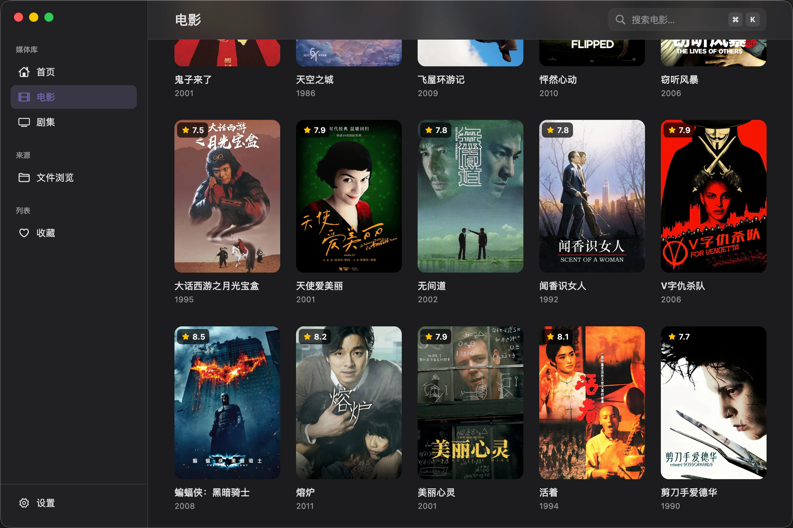
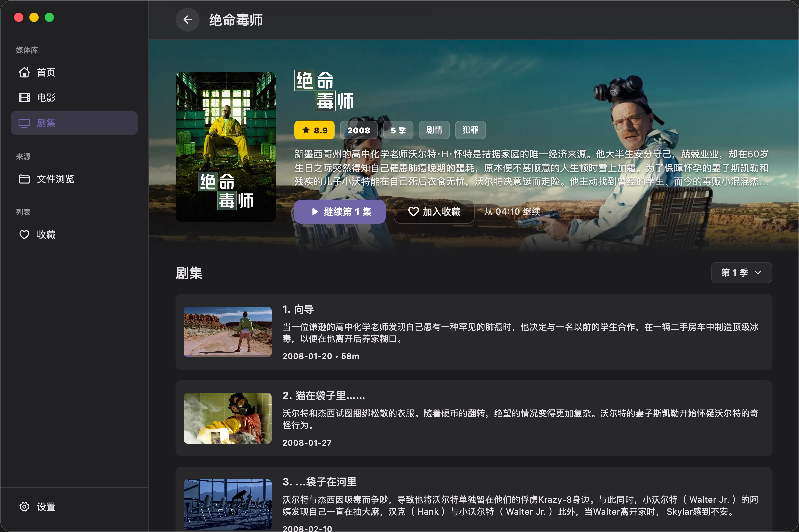
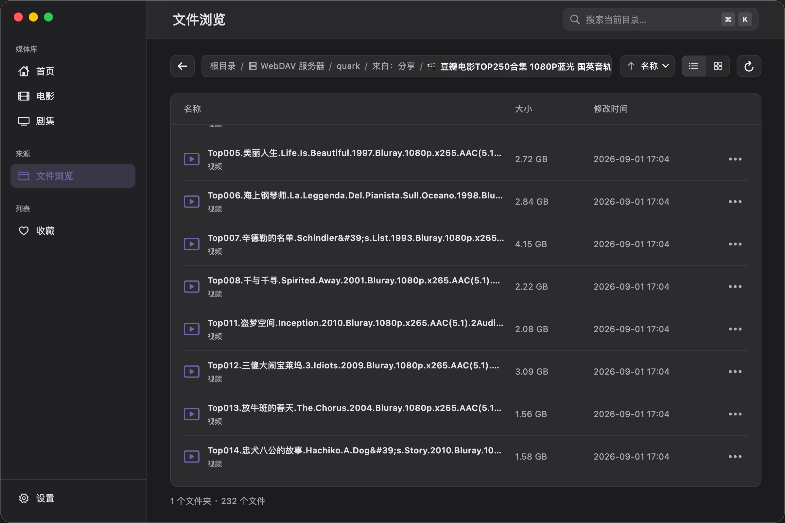
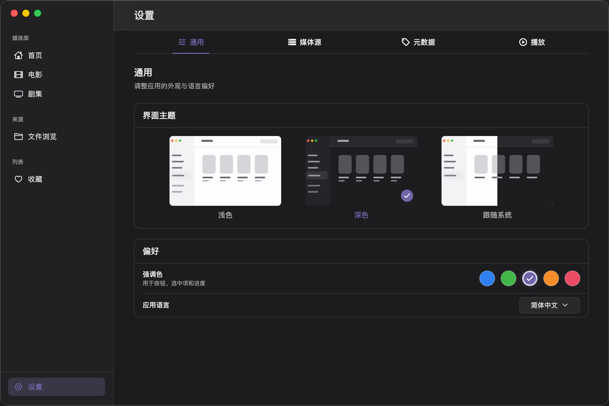

<p align="center">
  
</p>

<h1 align="center">Mochi Player</h1>

<p align="center">
  让你的私人影片库，拥有接近流媒体服务的浏览与播放体验。
</p>

<p align="center">
  <a href="https://github.com/sen-to/mochi_player/actions/workflows/windows.yml">
    
  </a>
  <a href="LICENSE">
    
  </a>
  
</p>

Mochi Player 是一款面向 Windows 与 macOS 的本地优先媒体库播放器。连接本地目录、WebDAV 或 SMB 网络共享后，它会扫描并整理视频，使用 TMDB 补全海报、简介、评分、演员和剧集信息，再以首页、海报墙与详情页重新呈现你的收藏。

从挑选影片到继续观看，一切都围绕舒服地看完一部作品：直接播放本地与 WebDAV 媒体，记忆播放进度，并支持多版本文件、音轨与字幕选择。SMB 媒体源可以扫描和浏览，当前捆绑播放器已验证无法直链播放。Mochi 先专注把个人媒体库的核心体验做好，再逐步加入更具个性的功能。

## 🖼️ 界面预览


| 电影 | 媒体详情 |
| --- | --- |
|  |  |

| 文件浏览 | 播放 |
| --- | --- |
|  |  |



## ✨ 功能

**媒体库**

- 🎞️ 浏览本地目录、WebDAV 与 SMB 网络共享
- 🗂️ 通过 WebDAV 接入 OpenList / AList 等聚合网盘服务
- 🧹 扫描媒体文件；已有路径不会重复入库，已有元数据不会重复刮削
- 🎬 使用 TMDB 匹配电影、剧集、演员、海报与背景图
- 🔎 浏览电影、剧集、收藏和继续观看内容

**播放**

- ▶️ 播放本地文件与 WebDAV 媒体；SMB 媒体源可扫描和浏览，当前捆绑播放器无法直链播放
- 🪟 播放器可开在独立窗口；也可收成小窗（mini 播放器），并支持置顶
- ⏱️ 记忆播放进度，支持多版本文件、音轨与内嵌 / 外挂字幕
- 🔠 可用 Mochi 字幕样式覆盖字幕文件自带的字体与颜色
- ⚡ 播放速度 0.5×–2×、实时缓存速度显示、拖动进度条时的时间预览

**外观**

- 🎨 支持浅色、深色、跟随系统主题与强调色选择
- 🌐 简体中文 / English，可在应用内切换或跟随系统；主窗口与播放器同步

## 🖥️ 支持平台

| 平台 | 状态 |
| --- | --- |
| macOS | 正在验证官方多视图迁移；暂无 CI，需要从源码构建 |
| Windows | 官方多视图版本 CI 构建已通过，原生交互仍待验收；见下方「下载与安装」 |

## 📥 下载与安装

构建产物通过 GitHub Actions 提供：

1. 打开 [Windows CI](https://github.com/sen-to/mochi_player/actions/workflows/windows.yml)，选择最近一次成功的运行；
2. 在页面底部的 **Artifacts** 区域下载 `mochi-player-windows-x64`；
3. 解压后直接运行其中的 `mochi_player.exe`。

> Artifact 仅保留 14 天，过期后需要重新触发构建。macOS 版本目前需要从源码构建。

## 🚀 开始使用

首次使用时，请依次完成以下配置：

1. 在“设置 → 元数据”中填写自己的 TMDB API Key。
2. 如网络环境需要，可开启 TMDB 代理并填写 HTTP 代理地址。
3. 在“设置 → 媒体源”中添加媒体源，支持三种类型：
   - **本地目录**：本机磁盘或已挂载的目录；
   - **WebDAV**：标准 WebDAV 服务，也包括 OpenList / AList 这类以 WebDAV 暴露的聚合网盘（默认端口 5244，路径形如 `/dav/quark`）；
   - **SMB**：局域网内的 SMB / Samba 共享。
4. 扫描媒体源并开始浏览、播放。

后续扫描会重新枚举目录并更新文件属性，保留播放进度和收藏；扫描无读取错误才清理消失的文件。已具备匹配元数据的文件通常跳过 TMDB 请求，显式 ID 变化或缺少元数据时会重新处理。

TMDB Key 由用户自行申请和管理，请不要将自己的 Key 提交到仓库或截图中。

## ⌨️ 快捷键

主窗口：

| 快捷键 | 作用 |
| --- | --- |
| `Cmd/Ctrl + K` | 聚焦搜索框 |
| `Esc` | 取消搜索框焦点（搜索框聚焦时） |

播放器：

| 快捷键 | 作用 |
| --- | --- |
| `Space` / `K` | 播放 / 暂停 |
| `←` / `J` | 后退 10 秒 |
| `→` / `L` | 前进 10 秒 |
| `↑` / `↓` | 音量 +5 / −5 |
| `M` | 静音切换 |
| `F` | 全屏切换 |
| `Esc` | 退出全屏 |
| `C` | 切换字幕轨 |
| `A` | 切换音轨 |

## 🛠️ 从源码运行

本迁移分支通过 FVM 固定使用 Flutter main 提交 `5ba8961b517919e97cd58e404b75dcdcf313017a`（见 [`.fvmrc`](.fvmrc)），启用官方实验单引擎多视图 API。SDK 由 FVM 下载，不需要自行编译引擎；项目开关也适用于 Release。当前 Windows 新宿主尚待运行时验收，详见 [ADR 0001](docs/decisions/0001-multi-window-strategy.md)。

构建前置条件：

- **macOS**：Xcode；最低部署目标为 macOS 12.0（见 `macos/Podfile`）。
- **Windows**：Visual Studio（2019 及以上，推荐 2022），安装时需勾选「使用 C++ 的桌面开发」工作负载。

首次运行前安装 FVM，并下载项目指定的 Flutter SDK。

macOS 推荐用 Homebrew：

```bash
brew install fvm
```

Windows 或其他平台，可以在已有 Dart / Flutter SDK 的前提下用 pub 安装：

```bash
dart pub global activate fvm
```

其他安装方式见 [FVM 官方文档](https://fvm.app/documentation/getting-started/installation)。用 `dart pub global activate` 安装时，`fvm` 可执行文件位于 `~/.pub-cache/bin`（Windows 为 `%LOCALAPPDATA%\Pub\Cache\bin`），需要把它加入 `PATH`。

然后安装 [`.fvmrc`](.fvmrc) 中锁定的 Flutter 版本：

```bash
fvm install
fvm use
```

随后统一通过 `fvm flutter` 执行 Flutter 命令：

```bash
fvm flutter pub get
fvm dart run tool/check_l10n.dart
fvm flutter gen-l10n
fvm flutter run -d macos
```

运行 Windows 版本：

```bash
fvm flutter run -d windows
```

构建 macOS Debug 应用：

```bash
fvm flutter build macos --debug
```

macOS 原生插件目前由 CocoaPods 管理。由于本项目尚未完成 SPM 迁移，`pubspec.yaml` 已将 Swift Package Manager 仅对本项目关闭，不需要修改 Flutter 的全局配置。该设置是过渡措施：Flutter [官方说明](https://docs.flutter.dev/packages-and-plugins/swift-package-manager/for-app-developers)指出 CocoaPods registry 将于 2026-12-02 转为只读，请在此之前确认插件的 SPM 兼容性并安排迁移，细节见[构建指南](docs/guides/build-macos.md#前置)。

提交代码前请执行：

```bash
fvm dart format lib test tool integration_test
fvm dart run tool/check_l10n.dart
fvm flutter gen-l10n
fvm flutter analyze --no-fatal-infos
fvm flutter test
```

本地化源文件位于 `lib/l10n/app_en.arb` 与 `app_zh.arb`，生成目录 `lib/l10n/generated/` 不提交。干净检出或修改 ARB 后，先检查资源并执行 `fvm flutter gen-l10n`，再进行静态检查、测试或构建，见 [本地化 ADR](docs/decisions/0004-i18n-l10n.md)。

代码统一使用 120 列，已在 [`analysis_options.yaml`](analysis_options.yaml) 的 `formatter.page_width` 中声明，因此 `fvm dart format` 无需额外参数。

修改 `lib/core/infrastructure/database/app_database.dart`、`media_tables.drift` 中的表定义或 `build.yaml` 中的 drift 配置后，需要重新生成数据库代码：

```bash
fvm dart run build_runner build
```

生成结果（`app_database.g.dart`）已随仓库提交，普通构建不需要执行这一步。数据库使用 drift + SQLite，首次运行创建 `mochi_player.sqlite`。当前 schema 为 2，包含显式季集归属、外键与组合唯一约束。项目尚未发布 Release：旧 SQLite 版本 1 开发库会重建，媒体源、元数据、进度与收藏重置，需要重新配置与扫描；不导入旧 Isar 数据。字段与 ORM 代码说明见 [数据模型](docs/architecture/data-model.md)。

## 🗂️ 项目结构

```
lib/
├── app/        启动组装、应用生命周期、外壳与路由
├── core/       跨功能的领域模型、基础设施（数据库 / 存储源 / 播放解析）与设计系统
├── features/   按功能划分：home、library、playback、settings
├── l10n/       本地化资源与语言状态
└── main.dart   应用入口，初始化共享服务并创建主视图
test/           与 lib/ 结构对应的单元测试与 Widget 测试
windows/ macos/ 各平台 runner
```

新增代码遵循 [代码组织与新增功能](docs/guides/code-organization.md) 中的骨架与依赖规则，类型命名遵循 [架构总览](docs/architecture/overview.md#命名约定)。功能内部按需设置 `application / domain / infrastructure / presentation`，不强制补齐空层。

播放通过 `PlaybackEngine` 门面接入，当前唯一实现为 media_kit + libmpv。播放控制、状态订阅、音轨 / 字幕、缓存与硬解设置、视频视图均通过门面；mpv 属性读写集中在后端实现。实施状态和未来直接接 libmpv 的条件见 [播放引擎 ADR](docs/decisions/0002-playback-engine.md)。

窗口采用官方 `WindowManager` / `WindowRegistry`：两个视图共享同一引擎、语言、主题、设置与后台数据库连接，播放器仍是独立窗口。关闭主窗口会保存进度、关闭播放器并退出程序；小窗采用 mini 播放器，系统画中画暂不纳入计划。

## 🔒 数据与隐私

- 媒体库、播放进度和应用设置仅保存在本机。
- 媒体源账号和密码只用于连接用户配置的 WebDAV 或 SMB 服务。
- 当前版本的媒体源凭据存储在本机应用数据库中，尚未接入系统钥匙串；请不要在不受信任的共享设备上保存高权限账号。
- 启用 TMDB 后，影片名称等用于匹配的信息会发送至用户配置的 TMDB API 地址；海报与背景图会从 TMDB 图片服务下载并缓存。

## 📌 已知限制

- 系统原生文件选择器与菜单的语言受操作系统控制；应用内语言切换不改变媒体文件名、TMDB 元数据语言或字幕语言优先级。
- media_kit 已明确有限维护，完整播放能力仍需两平台样片验收；目前通过播放引擎门面隔离后端，详见 [ADR 0002](docs/decisions/0002-playback-engine.md)。
- TMDB 匹配依赖文件命名质量，少数作品可能需要后续手动处理。
- SMB 媒体源可扫描和浏览；用户已实测当前捆绑播放器无法打开 / seek SMB 文件，本地 HTTP 回源尚未实现。请先在系统中挂载共享，再按本地目录添加播放。
- 关闭媒体库主窗口会先保存进度、关闭播放器并退出整个应用；单独关闭播放器则保留媒体库窗口。希望继续观看时请最小化主窗口。正常清理有超时兜底，超时情况下不保证最后快照完整，见 [多窗口策略 ADR](docs/decisions/0001-multi-window-strategy.md)。
- Windows 曾出现打开播放器后媒体库主窗口鼠标与键盘无响应（界面仍在渲染），关闭播放器也不恢复的现象。runner 已调整 UI 线程策略；完整根因与修复效果仍需 Windows 运行时验证，不能保证更换窗口方案就能消除问题。

## 🤝 参与贡献

欢迎通过 Issue 反馈问题、提出功能建议，或提交 Pull Request。提交前请确保格式化、静态检查和测试均通过。

架构说明、平台构建与测试指南、技术决策记录见[开发者文档](docs/README.md)。

## 🙏 致谢

本产品使用 [TMDB](https://www.themoviedb.org/) API，但未获得 TMDB 的认可或认证。

## 📄 许可证

本项目代码采用 [GNU GPL v3.0](LICENSE) 许可证发布。

`Mochi Player` 名称与 Logo 不随代码许可证授权；Fork 或衍生发行版请使用不同的名称和
视觉标识。详见 [品牌使用政策](TRADEMARKS.md)。
