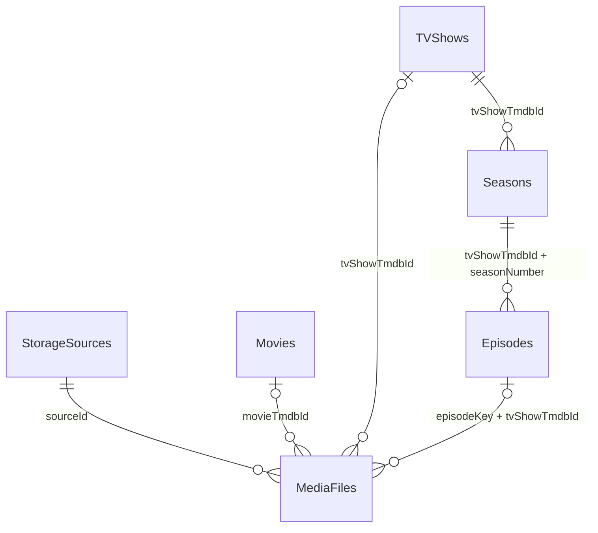
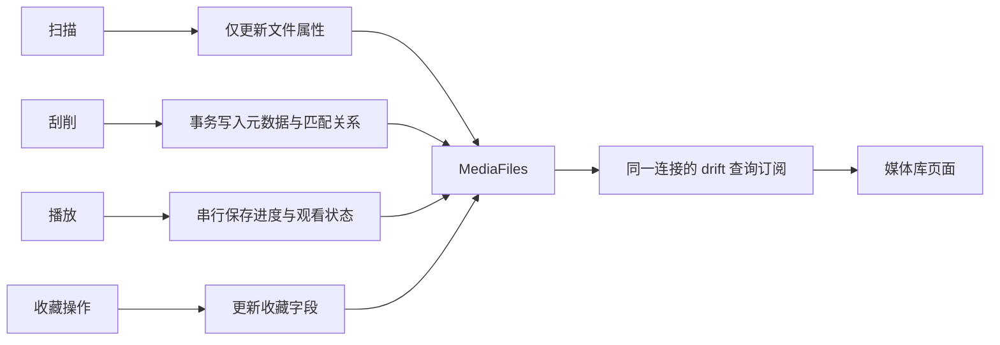

# 数据模型与持久化

核对日期：2026-10-14。本文描述当前 schema 与读写语义；选型及迁移边界见 [ADR 0003](../decisions/0003-persistence-migration.md)，规则与算法见 [算法说明](algorithms.md)。

## 存储分工

| 数据 | 存放位置 | 所有权 |
| --- | --- | --- |
| 媒体文件、元数据、进度、收藏、媒体源 | drift + SQLite：应用文档目录的 `mochi_player.sqlite` | 应用共享数据库 |
| 应用设置、主题、语言偏好 | SharedPreferences | 共享设置 / 主题 / 语言控制器 |
| TMDB 图片 | flutter_cache_manager 文件缓存，30 天过期、上限 1200 条 | 图片缓存服务 |

[AppDatabase](../../lib/core/infrastructure/database/app_database.dart) 收集 Dart 表定义及 [media_tables.drift](../../lib/core/infrastructure/database/media_tables.drift) 中的 SQL 表定义，`DatabaseService` 管理连接与写入，`LibraryRepository` 提供读取投影。生产连接使用 `NativeDatabase.createInBackground`；主视图与播放器共用同一个后台 SQLite 连接，播放器关闭不关闭数据库，应用退出统一关闭。

数据库服务是由组装入口创建的普通实例，不通过全局单例获取。[ApplicationServices](../../lib/app/bootstrap/application_services.dart) 将同一实例注入来源仓库、库查询 / 扫描 / 刮削和播放持久化适配。页面通过 `MediaLibraryProvider` 的应用查询入口读取，具体 `LibraryRepository` 不公开给页面。

## 表概览

| 表定义 | 主键 / 业务唯一键 | 内容 |
| --- | --- | --- |
| `MediaFiles` | 自增 `id`；`(sourceId, path)` 组合唯一 | 实际文件、解析属性、元数据关联、技术信息、进度与收藏 |
| `Movies` | `tmdbId` 主键 | 电影标题、图片、日期、简介、评分、类型与演员 |
| `TVShows` | `tmdbId` 主键 | 剧集元数据、状态与季集数量 |
| `Seasons` | `(tvShowTmdbId, seasonNumber)` 组合主键 | 所属剧、季号、标题、图片、简介 |
| `Episodes` | `episodeKey` 主键；`(tvShowTmdbId, seasonNumber, episodeNumber)` 组合唯一 | 所属剧、季号、集号、真实 TMDB ID、标题、日期、剧照与客串演员 |
| `StorageSources` | `sourceId` 主键 | 类型、名称、地址、根路径、启用状态与凭据 |

六表分别表达配置来源、实际文件、电影、剧、季、集。元数据与实际文件分开，使同一标题可对应多个来源和文件版本；演员 / 类型暂不拆表，因为当前只用于展示，不提供按演员关联查询。

## 字段字典（schema 2）

下表列出全部持久化字段，SQL 列名与 Dart 属性名分别标注。`NULL` 为“否”表示 `NOT NULL`；`PK` 为主键，`FK` 为外键。组合约束以表后的完整定义为准，不将其中某个字段误标为单列唯一。

SQLite 类型列表示当前存储映射：`String → TEXT`、`int → INTEGER`、`double → REAL`、`bool → INTEGER（0 / 1）`、`DateTime → TEXT（ISO-8601）`。SQL 源中的 `DATETIME`、`BOOLEAN` 是 drift 的逻辑类型，日期 TEXT 映射由 `build.yaml` 配置。表未启用 SQLite `STRICT`，这里不将类型亲和性描述为数据库严格类型校验。

**当前所有字段均没有 SQL `DEFAULT` 子句。** `id` 省略时由 SQLite 自增机制分配；其余非空字段需要写入方提供。领域构造函数中的 `0`、`false`、空列表等默认值属于应用默认值，不是数据库默认值。

### MediaFiles → `media_files`

定义：[media_tables.drift](../../lib/core/infrastructure/database/media_tables.drift)。领域行模型：[MediaFile](../../lib/core/domain/media/media_file.dart)。

| SQL 列 | Dart 属性 / 类型 | SQLite 类型 | NULL | 含义与约束 |
| --- | --- | --- | --- | --- |
| `id` | `id: int` | INTEGER | 否 | PK，自增，内部文件行身份 |
| `source_id` | `sourceId: String` | TEXT | 否 | FK → `storage_sources.source_id`；来源 / 路径组合唯一成员 |
| `path` | `path: String` | TEXT | 否 | 来源内路径；来源 / 路径组合唯一成员 |
| `file_name` | `fileName: String` | TEXT | 否 | 文件名 |
| `parsed_title` | `parsedTitle: String` | TEXT | 否 | 从文件名解析的标题 |
| `parsed_year` | `parsedYear: int?` | INTEGER | 是 | 解析年份；没有年份范围 CHECK |
| `parsed_season` | `parsedSeason: int?` | INTEGER | 是 | 解析季号；非空时 ≥ 0 |
| `parsed_episode` | `parsedEpisode: int?` | INTEGER | 是 | 解析集号；非空时 ≥ 0 |
| `media_type` | `mediaType: MediaType` | TEXT | 否 | 枚举名：`movie / episode / folder / unknown`；参与匹配类型 CHECK |
| `explicit_tmdb_id` | `explicitTmdbId: String?` | TEXT | 是 | 文件名显式指定的候选 ID，尚未匹配，**不是 FK** |
| `movie_tmdb_id` | `movieTmdbId: String?` | TEXT | 是 | FK → `movies.tmdb_id`；仅电影可设置 |
| `tv_show_tmdb_id` | `tvShowTmdbId: String?` | TEXT | 是 | FK → `t_v_shows.tmdb_id`；也是单集组合 FK 成员，仅剧集文件可设置 |
| `episode_key` | `episodeKey: String?` | TEXT | 是 | 与所属剧组成 FK → `episodes(episode_key, tv_show_tmdb_id)`；不能单独绑定不存在的单集 |
| `metadata_match_status` | `metadataMatchStatus: MetadataMatchStatus` | TEXT | 否 | 枚举名：`pending / confirmed / unmatched / ambiguous` |
| `size` | `size: int` | INTEGER | 否 | 文件大小，字节，≥ 0 |
| `container` | `container: String?` | TEXT | 是 | 容器 / 扩展名标签 |
| `width` | `width: int?` | INTEGER | 是 | 视频宽度，像素；没有正数 CHECK |
| `height` | `height: int?` | INTEGER | 是 | 视频高度，像素；没有正数 CHECK |
| `video_codec` | `videoCodec: String?` | TEXT | 是 | 视频编码标签 |
| `audio_codec` | `audioCodec: String?` | TEXT | 是 | 音频编码标签 |
| `audio_channels` | `audioChannels: String?` | TEXT | 是 | 声道描述，文本，不是整数声道数 |
| `is_hdr` | `isHdr: bool` | INTEGER | 否 | HDR 标记；SQL 表没有额外的 0 / 1 CHECK |
| `hdr_format` | `hdrFormat: String?` | TEXT | 是 | HDR 格式标签 |
| `version_label` | `versionLabel: String?` | TEXT | 是 | 文件版本标签 |
| `duration` | `duration: int` | INTEGER | 否 | 时长，毫秒，≥ 0；0 表示尚无有效时长 |
| `position` | `position: int` | INTEGER | 否 | 播放位置，毫秒，≥ 0；位置上限由写入服务裁剪，非 SQL CHECK |
| `watch_status` | `watchStatus: WatchStatus` | TEXT | 否 | 枚举名：`notStarted / watching / completed`；写入服务计算，不是生成列 |
| `last_watched_at` | `lastWatchedAt: DateTime?` | TEXT | 是 | 最近观看时间；进度写入服务使用 UTC |
| `is_favorite` | `isFavorite: bool` | INTEGER | 否 | 文件收藏标记；SQL 表没有额外的 0 / 1 CHECK |
| `added_at` | `addedAt: DateTime` | TEXT | 否 | 首次入库时间，重复扫描保留 |

表级约束：

```sql
UNIQUE (source_id, path)
FOREIGN KEY (episode_key, tv_show_tmdb_id)
  REFERENCES episodes (episode_key, tv_show_tmdb_id)
CHECK (movie_tmdb_id IS NULL OR
  (media_type = 'movie' AND tv_show_tmdb_id IS NULL AND episode_key IS NULL))
CHECK (tv_show_tmdb_id IS NULL OR media_type = 'episode')
CHECK (episode_key IS NULL OR tv_show_tmdb_id IS NOT NULL)
CHECK (size >= 0 AND duration >= 0 AND position >= 0)
CHECK (parsed_season IS NULL OR parsed_season >= 0)
CHECK (parsed_episode IS NULL OR parsed_episode >= 0)
```

### Movies → `movies`

定义：[Movies](../../lib/core/infrastructure/database/app_database.dart)。领域行模型：[Movie](../../lib/core/domain/media/movie.dart)。

| SQL 列 | Dart 属性 / 类型 | SQLite 类型 | NULL | 含义与约束 |
| --- | --- | --- | --- | --- |
| `tmdb_id` | `tmdbId: String` | TEXT | 否 | PK，TMDB 电影 ID；存文本，没有数字格式 CHECK |
| `title` | `title: String` | TEXT | 否 | 展示标题 |
| `original_title` | `originalTitle: String?` | TEXT | 是 | 原始标题 |
| `release_year` | `releaseYear: int?` | INTEGER | 是 | 上映年份 |
| `release_date` | `releaseDate: DateTime?` | TEXT | 是 | 上映日期 |
| `poster_url` | `posterUrl: String?` | TEXT | 是 | 海报 URL |
| `backdrop_url` | `backdropUrl: String?` | TEXT | 是 | 背景图 URL |
| `logo_url` | `logoUrl: String?` | TEXT | 是 | 标题 Logo URL |
| `overview` | `overview: String?` | TEXT | 是 | 简介 |
| `certification` | `certification: String?` | TEXT | 是 | 内容分级标签 |
| `rating` | `rating: double` | REAL | 否 | 评分；没有 0–10 范围 CHECK |
| `genres` | `genres: List<String>` | TEXT | 否 | JSON 类型名列表 |
| `cast` | `cast: List<Artist>` | TEXT | 否 | JSON 演员列表；内部演员 ID 不是表间 FK |

除 PK / NOT NULL 外，没有单独 FK、UNIQUE 或表级 CHECK。

### TVShows → `t_v_shows`

定义：[TVShows](../../lib/core/infrastructure/database/app_database.dart)。领域行模型：[TVShow](../../lib/core/domain/media/tv_show.dart)。实际 SQL 表名是 **`t_v_shows`**，不是 `tv_shows`。

| SQL 列 | Dart 属性 / 类型 | SQLite 类型 | NULL | 含义与约束 |
| --- | --- | --- | --- | --- |
| `tmdb_id` | `tmdbId: String` | TEXT | 否 | PK，TMDB 剧 ID；与电影 ID 不共用身份空间 |
| `title` | `title: String` | TEXT | 否 | 展示剧名 |
| `original_title` | `originalTitle: String?` | TEXT | 是 | 原始剧名 |
| `release_year` | `releaseYear: int?` | INTEGER | 是 | 首播年份 |
| `first_air_date` | `firstAirDate: DateTime?` | TEXT | 是 | 首播日期 |
| `poster_url` | `posterUrl: String?` | TEXT | 是 | 海报 URL |
| `backdrop_url` | `backdropUrl: String?` | TEXT | 是 | 背景图 URL |
| `logo_url` | `logoUrl: String?` | TEXT | 是 | 标题 Logo URL |
| `overview` | `overview: String?` | TEXT | 是 | 简介 |
| `certification` | `certification: String?` | TEXT | 是 | 内容分级标签 |
| `rating` | `rating: double` | REAL | 否 | 评分；没有范围 CHECK |
| `genres` | `genres: List<String>` | TEXT | 否 | JSON 类型名列表 |
| `cast` | `cast: List<Artist>` | TEXT | 否 | JSON 演员列表 |
| `status` | `status: String?` | TEXT | 是 | TMDB 剧状态文本，不是本地观看状态枚举 |
| `number_of_seasons` | `numberOfSeasons: int?` | INTEGER | 是 | TMDB 季总数，不是本地已导入季数 |
| `number_of_episodes` | `numberOfEpisodes: int?` | INTEGER | 是 | TMDB 集总数，不是本地可播放文件数 |

除 PK / NOT NULL 外，没有单独 FK、UNIQUE 或表级 CHECK。领域属性 `seasons` 是详情查询组装的列表，不是 SQL 列。

### Seasons → `seasons`

定义：[Seasons](../../lib/core/infrastructure/database/app_database.dart)。领域行模型：[Season](../../lib/core/domain/media/season.dart)。

| SQL 列 | Dart 属性 / 类型 | SQLite 类型 | NULL | 含义与约束 |
| --- | --- | --- | --- | --- |
| `tv_show_tmdb_id` | `tvShowTmdbId: String` | TEXT | 否 | 组合 PK 成员；FK → `t_v_shows.tmdb_id` |
| `season_number` | `seasonNumber: int` | INTEGER | 否 | 组合 PK 成员，≥ 0；0 为特别篇 |
| `title` | `title: String` | TEXT | 否 | 季标题 |
| `poster_url` | `posterUrl: String?` | TEXT | 是 | 季海报 URL |
| `overview` | `overview: String?` | TEXT | 是 | 季简介 |
| `number_of_episodes` | `numberOfEpisodes: int?` | INTEGER | 是 | 季元数据中的集数；没有非负 CHECK |

表级约束：`PRIMARY KEY (tv_show_tmdb_id, season_number)`、`CHECK (season_number >= 0)`。领域属性 `episodes` 是详情查询组装的列表，不是 SQL 列。

### Episodes → `episodes`

定义：[media_tables.drift](../../lib/core/infrastructure/database/media_tables.drift)。领域行模型：[Episode](../../lib/core/domain/media/episode.dart)。

| SQL 列 | Dart 属性 / 类型 | SQLite 类型 | NULL | 含义与约束 |
| --- | --- | --- | --- | --- |
| `episode_key` | `episodeKey: String`（getter） | TEXT | 否 | PK，剧 / 季 / 集业务键；CHECK 保证与归属字段一致 |
| `tv_show_tmdb_id` | `tvShowTmdbId: String` | TEXT | 否 | 与季号组成 FK → `seasons(tv_show_tmdb_id, season_number)`；两个组合 UNIQUE 的成员 |
| `season_number` | `seasonNumber: int` | INTEGER | 否 | 组合 FK / 三字段 UNIQUE 成员，≥ 0 |
| `tmdb_id` | `tmdbId: String?` | TEXT | 是 | TMDB 返回的真实单集 ID；不是 PK，也没有单列 UNIQUE / FK |
| `episode_number` | `episodeNumber: int` | INTEGER | 否 | 三字段 UNIQUE 成员，≥ 0 |
| `title` | `title: String` | TEXT | 否 | 集标题 |
| `air_date` | `airDate: DateTime?` | TEXT | 是 | 播出日期 |
| `overview` | `overview: String?` | TEXT | 是 | 集简介 |
| `still_url` | `stillUrl: String?` | TEXT | 是 | 剧照 URL |
| `guest_stars` | `guestStars: List<Artist>` | TEXT | 否 | JSON 客串演员列表 |

表级约束：

```sql
UNIQUE (tv_show_tmdb_id, season_number, episode_number)
UNIQUE (episode_key, tv_show_tmdb_id)
FOREIGN KEY (tv_show_tmdb_id, season_number)
  REFERENCES seasons (tv_show_tmdb_id, season_number) ON DELETE CASCADE
CHECK (season_number >= 0 AND episode_number >= 0)
CHECK (episode_key = tv_show_tmdb_id || '_s' || season_number || 'e' || episode_number)
```

`episodeKey` 在领域对象中由 getter 计算，入库时保存为真实列；不是 SQLite 生成列。数据库约束保证读取后计算结果与保存值相同。

### StorageSources → `storage_sources`

定义：[StorageSources](../../lib/core/infrastructure/database/app_database.dart)。生成行模型 `StorageSourceRow` 经 [存储源仓库](../../lib/core/infrastructure/storage/storage_source_repository.dart) 转为领域对象。

| SQL 列 | Dart 属性 / 类型 | SQLite 类型 | NULL | 含义与约束 |
| --- | --- | --- | --- | --- |
| `source_id` | `sourceId: String` | TEXT | 否 | PK，应用内稳定来源 ID |
| `name` | `name: String` | TEXT | 否 | 来源展示名称；名称不要求唯一 |
| `type` | `type: String` | TEXT | 否 | `local / webDav / smb`；按领域枚举解析，没有 SQL 枚举 CHECK |
| `endpoint` | `endpoint: String` | TEXT | 否 | 本地路径或协议端点 |
| `root_path` | `rootPath: String` | TEXT | 否 | 来源内根路径 |
| `enabled` | `enabled: bool` | INTEGER | 否 | 启用标记；drift 生成 `CHECK (enabled IN (0, 1))` |
| `username` | `username: String` | TEXT | 否 | 用户名，未设置时应用写空字符串 |
| `password` | `password: String` | TEXT | 否 | 密码，未设置时应用写空字符串；当前明文存储 |

没有外键或额外 UNIQUE；`source_id` 的主键已保证唯一。名称 / 端点非空白、根路径格式等由存储源服务链校验，不是 SQL 非空字符串 CHECK。

### 外键与更新 / 删除动作

下表按 SQL 名列出全部 6 组外键。当前均未声明 `ON UPDATE`，使用 `NO ACTION`；均未声明延迟检查。`NO ACTION` 不等于自动清空引用字段。

| 子表字段 | 父表字段 | ON DELETE | 说明 |
| --- | --- | --- | --- |
| `media_files.source_id` | `storage_sources.source_id` | CASCADE | 删除来源同时删除文件 |
| `media_files.movie_tmdb_id` | `movies.tmdb_id` | NO ACTION | 被文件引用的电影不能直接删除 |
| `media_files.tv_show_tmdb_id` | `t_v_shows.tmdb_id` | NO ACTION | 被文件引用的剧不能直接删除 |
| `media_files(episode_key, tv_show_tmdb_id)` | `episodes(episode_key, tv_show_tmdb_id)` | NO ACTION | 单集必须属于该剧；被文件引用时不能直接删除 |
| `seasons.tv_show_tmdb_id` | `t_v_shows.tmdb_id` | CASCADE | 删除无文件引用的剧级联删除季 |
| `episodes(tv_show_tmdb_id, season_number)` | `seasons(tv_show_tmdb_id, season_number)` | CASCADE | 删除季级联删除集；若集被文件引用则整次删除失败 |

单列可空外键在值为 NULL 时允许暂未匹配；单集组合外键由额外 CHECK 保证设置 `episode_key` 时必须同时设置所属剧。不存在自动 `SET NULL` 策略。

### 索引清单

| 表 | 索引 / 约束 | 列顺序 | 用途 |
| --- | --- | --- | --- |
| `media_files` | 整数 PK / rowid | `id` | 内部行定位，无需额外 `id` 索引 |
| `media_files` | UNIQUE 自动索引 | `source_id, path` | 来源范围、路径查找与扫描 upsert |
| `media_files` | `media_files_movie_added_idx` | `movie_tmdb_id, added_at` | 电影版本与最早添加时间 |
| `media_files` | `media_files_show_order_idx` | `tv_show_tmdb_id, parsed_season, parsed_episode, path` | 剧集版本过滤与排序 |
| `media_files` | `media_files_episode_key_idx` | `episode_key` | 单集文件定位及引用检查 |
| `media_files` | `media_files_watch_status_idx` | `watch_status` | 观看状态过滤 |
| `media_files` | `media_files_last_watched_at_idx` | `last_watched_at` | 最近观看相关访问 |
| `media_files` | `media_files_is_favorite_idx` | `is_favorite` | 收藏过滤 |
| `media_files` | `media_files_added_at_idx` | `added_at` | 添加时间相关访问 |
| `movies` | PK 自动索引 | `tmdb_id` | 元数据定位与文件关联 |
| `t_v_shows` | PK 自动索引 | `tmdb_id` | 元数据定位与文件关联 |
| `seasons` | 组合 PK 自动索引 | `tv_show_tmdb_id, season_number` | 剧所属季查询、排序与集的引用目标 |
| `episodes` | PK 自动索引 | `episode_key` | 单集业务键定位与 upsert |
| `episodes` | UNIQUE 自动索引 | `tv_show_tmdb_id, season_number, episode_number` | 季集唯一性、按剧读取与排序 |
| `episodes` | UNIQUE 自动索引 | `episode_key, tv_show_tmdb_id` | 文件组合 FK 的唯一引用目标 |
| `storage_sources` | PK 自动索引 | `source_id` | 来源定位与文件关联 |

自动索引的内部名字由 SQLite 生成，不作为代码契约。这里只有文件表另建了 7 个命名索引；其余表使用主键 / 唯一约束形成的索引，没有额外命名索引。

### 编码及校验边界

- 枚举由 drift 按名称映射，但当前没有枚举取值集合的 SQL CHECK；直接 SQL 写入未知枚举字符串可能在映射时失败。
- JSON 列由转换器序列化；当前没有 `json_valid()` CHECK。`Artist` JSON 对象含 `tmdbId`、`name`、`character`、`profileUrl`，其中 `name` 非空类型，其余允许 null；这些不是演员关系表字段或外键。
- `NOT NULL` 不禁止空字符串。标题、路径、URL、ID 格式及评分范围等没有统一 SQL 格式校验；不能将应用校验或上游数据约定写成数据库约束。
- 宽高、元数据季集总数、日期格式、进度与观看状态的一致性等没有 SQL CHECK；当前通过映射 / 写入规则维护。数据库已有约束的具体范围以本字段字典及 schema 快照为准。
- `MediaFile.storageKey`、`MediaFile.progress / quality`、`TVShow.seasons`、`Season.episodes` 等为派生或查询组装属性，不额外持久化。

## 关系与设计取舍

### 主键与身份策略

六张表均有主键，但只有文件使用自增整数。主键承担行身份与唯一性，不要求每个表都使用整数代理键：

- 文件有较长的来源 / 路径组合业务键，并可能有多个物理版本；内部 `id` 用于查询结果定位和稳定排序，业务唯一性仍由 `(sourceId, path)` 保证。
- 来源已经有应用生成的稳定 `sourceId`，没有再保留第二套整数身份。
- 当前电影 / 剧元数据以 TMDB 为身份来源，分别使用 `tmdbId`；两个表的相同 ID 不代表同一个标题，查询必须同时区分类型。
- 一季由“所属剧 + 季号”确定；单集使用 `episodeKey`，另通过三字段唯一约束和 CHECK 固定归属，不把真实 TMDB 单集 ID 当作唯一的内部身份。

增加代理 `id` 后仍需要业务唯一约束，并不自动改善范式或性能。如果未来需要持久化无 TMDB ID 的标题、多提供方元数据或本地自建标题，应重新评估电影 / 剧的内部身份和外部标识映射；当前尚未实现这套扩展，不把它写成现有能力。

### 范式与当前适用范围

本设计按来源、文件、电影、剧、季、集拆分实体，适用于当前单用户、文件系统媒体源与 TMDB 元数据功能；数据库完整性与现有查询行为有测试，但大库容量尚未得到实测证明。

不宣称整个 schema 严格满足第三范式。范式需要按各表的候选键和字段函数依赖分析，而非仅看有没有主键或外键。当前明确保留的反规范化取舍包括：

- `MediaFiles.episodeKey` 已能确定所属剧，文件仍保存 `tvShowTmdbId`，方便按剧过滤；组合外键保证这份冗余一致。
- `watchStatus` 可由位置、时长和完成规则计算，但仍持久化以供 SQL 查询；通过统一规则和字段级写入维护，数据库并未自动重算。
- 演员、类型与客串演员保存为 JSON。SQLite 将其作为一个 TEXT 值，但按传统关系模型把这些内容视为多值属性时，没有展开为独立关系；不能据此宣称已完成严格的原子属性规范化。

当前 schema 是实体拆分与有约束冗余的组合，不统一标注为严格 2NF / 3NF。多账户、按演员检索或跨版本共享观看状态等需求会改变实体关系与函数依赖，届时需重新评估相关表的规范化程度。

`Episodes.episodeKey` 是项目的稳定业务键，例如 `123_s1e1`；`tmdbId` 保存接口返回的真实单集 ID，可为空。季、集归属通过显式字段查询，不解析业务键字符串。以下关系均已声明 SQL 外键：



一个逻辑标题可以对应多个实际文件，例如同一电影的不同来源、分辨率或编码版本。文件进度与收藏存于 `MediaFiles`；标题级收藏操作批量修改该标题下的文件，尚无独立收藏表。

文件字段分别保存显式解析 ID、已匹配电影 ID、所属剧集 ID、单集键与匹配状态，不再用一个派生 `tmdbId` 混合电影 ID 和单集键。版本查询和标题收藏接收 `LibraryItem`，按电影 / 剧类型选择关联字段；电影与剧的相同 TMDB 数字 ID 不会串查或同时修改。

### 字段取舍与完整性

| 设计 | 原因与约束 |
| --- | --- |
| 文件的 `sourceId + path` | 数据库组合唯一，避免拼接字符串分隔符造成身份冲突；领域 `storageKey` 仅为任务和队列中的派生标识，不存数据库 |
| 来源只保留 `sourceId` 主键 | 对外身份已经稳定，删除没有业务用途的第二个自增 ID |
| `parsedSeason / parsedEpisode` 与匹配关系分开 | 文件名解析和元数据匹配是不同阶段；未匹配的文件也可浏览、排序与播放 |
| 文件保留 `tvShowTmdbId` 与 `episodeKey` | 支持直接按剧查询版本和播放队列；组合外键确保单集确实属于该剧，不能将两个各自有效但不相属的 ID 混用 |
| 单集业务键与三字段唯一约束 | 稳定关联标识与业务归属均受约束；CHECK 保证业务键与剧 / 季 / 集字段一致，季号 0 的特别篇合法 |
| `watchStatus` 保留为查询字段 | 是进度的派生状态，便于 SQL 筛选；写进度时统一计算，数据库、续播与界面共用 `WatchProgressPolicy` 的 95% 阈值 |
| 进度 / 收藏保留在文件表 | 继续采用每物理文件独立进度、标题收藏批量修改文件的产品语义，不引入账户或独立标题状态表 |

数据库 CHECK 拒绝负文件大小、负时长 / 位置、负季集号，以及电影 / 剧集关联混用。外键拒绝不存在的来源、电影、剧、季和单集；事务负责多次操作的原子性，两者不能互相替代。匹配状态与业务操作的完整语义仍由字段级写入服务维护，不宣称所有业务规则均已转为 SQL 约束。

### 删除策略

- 删除媒体源：数据库 `ON DELETE CASCADE` 删除所属文件；同时删除路径返回受影响文件数。共享元数据保留。
- 删除无文件引用的剧：级联删除季和集；删除季同样级联删除集。
- 删除仍被文件引用的电影、剧或单集：拒绝删除，避免静默丢失匹配关系；回收元数据时必须先确定无引用。
- `clearLibrary` 在事务内先删除文件，再清空元数据，保留媒体源配置。

## 映射、字段编码与索引

- drift `@UseRowClass` / SQL `WITH` 直接构造不可变领域模型；Dart 表生成 `toInsertable()`，SQL 表通过 typed Companion 写入。媒体源使用生成的 `StorageSourceRow` 经服务转换，不另设一套元数据 Entity。
- 类型、演员和客串演员列表由 [JSON 转换器](../../lib/core/infrastructure/database/json_converters.dart) 存为 TEXT，不是关联表。当前满足展示，复杂的按演员 / 类型查询仍需评估。
- 枚举存名称；日期按 [build.yaml](../../build.yaml) 配置存 ISO 文本以保留微秒精度。播放位置和时长以毫秒存储。
- 文件唯一索引 `(sourceId, path)` 同时支持来源路径查找，不再另建重复的来源单列索引；电影索引 `(movieTmdbId, addedAt)` 支持按电影找版本与最早添加时间；剧集索引 `(tvShowTmdbId, parsedSeason, parsedEpisode, path)` 支持剧集版本排序；保留单集键、观看状态、最近观看时间、收藏与添加时间索引，移除缺乏当前独立查询用途的显式 ID 索引。
- 季组合主键与集的 `(tvShowTmdbId, seasonNumber, episodeNumber)` 唯一索引支持归属过滤与排序。单集的 `(episodeKey, tvShowTmdbId)` 唯一约束是文件组合外键的目标，不是多余的业务主键。
- 每个连接在开放业务读写前执行 `PRAGMA foreign_keys=ON`，真实 SQLite 测试确认拒绝错误引用和执行删除级联。
- 文件与单集表在 `media_tables.drift` 声明组合外键，让生成器识别完整关系和季 → 集的级联订阅通知；其他四表使用 Dart 声明，不重复定义同一张表。不手工修改生成代码或使用内部通知 API。SQL 表与现有领域模型的组合方式见 [drift 文件](https://drift.simonbinder.eu/sql_api/drift_files/) 与 [行模型映射](https://drift.simonbinder.eu/dart_api/rows/)。

索引按过滤、关联和排序路径配置，不为每个字段建索引，也不重复建立与主键 / 唯一约束相同的索引。当前组合索引的查询计划已验证；收藏、观看状态等索引在真实规模下的收益与写入成本仍需负载测试，不把“已有索引”当作性能保证。

当前没有自定义 SQL 触发器。引用完整性、删除传播和字段合法性分别由外键、`ON DELETE CASCADE` 与 CHECK 实现；进度状态通过应用规则更新，drift 的生成通知规则负责使订阅跟随级联变化，它不是应用自建的 SQL 触发器。若以后允许其他写入方绕过应用服务，并必须自动维护派生状态，再评估生成列、触发器或统一写入接口。

### drift / ORM 代码位置

| 文件 | 职责 |
| --- | --- |
| [app_database.dart](../../lib/core/infrastructure/database/app_database.dart) | 电影 / 剧 / 季 / 来源表、领域模型映射、SQL 表入口与 schema 生命周期 |
| [media_tables.drift](../../lib/core/infrastructure/database/media_tables.drift) | 文件与单集表、组合外键、CHECK、索引及 SQL 行模型映射 |
| [app_database.g.dart](../../lib/core/infrastructure/database/app_database.g.dart) | drift 生成的列、映射、Companion 与数据库实现，不手工修改 |
| [database_service.dart](../../lib/core/infrastructure/database/database_service.dart) | 连接、字段级写入、事务与简单类型化查询 |
| [library_repository.dart](../../lib/features/library/infrastructure/library_repository.dart) | 类型化查询与复杂 SQL，关联、聚合、排序、页面投影及订阅 |
| [json_converters.dart](../../lib/core/infrastructure/database/json_converters.dart) | JSON 列与领域列表互转 |

## 写入边界



- 扫描按 128 个文件分批 batch upsert，保留已有行 ID、添加时间、用户进度和收藏；媒体类型变化时清空不兼容的匹配关系。
- 扫描成功才删除本来源未再出现的文件；目录读取失败或应用退出中断扫描时跳过删除，成功发现的文件仍保存。
- 元数据与文件匹配在事务内提交；季集导入使用 batch。
- 进度裁剪到合法范围，可选更新时长并记录 UTC 观看时间；位置为 0 为未开始，达到时长 95% 为已完成，其余为观看中。
- 进度与收藏各自局部 UPDATE，旧扫描 / 刮削快照不会覆盖它们。
- 删除来源同时删除所属文件，保留共享元数据；`clearLibrary` 清空库数据但保留媒体源配置。

## 读取、订阅与容量边界

SQL 完成列表搜索、排序、收藏去重和每标题续播目标选择，再返回有限投影。首页保留 15 条最近添加、15 条续播和 1 条 Hero；详情、版本与队列按相关标题读取，不加载完整元数据 Catalog。电视剧详情一次查询本剧所有季、一次查询本剧所有集，再按季分组，不再逐季查询单集。

网格初始 `LIMIT 100`，滚动时增大 100 再读取前 N 条，属于扩展结果窗口，**不是 OFFSET 或游标分页**。搜索通过自定义确定性函数 `library_normalize` 与 `instr` 计算匹配；不是 FTS 全文检索。大库性能需要查询计划和容量测试，已有单列索引不代表所有过滤和排序都能利用索引。

播放器写入与媒体库查询使用同一 drift 连接，订阅直接刷新，不回传变更键、不手动失效。双独立连接只用于并发 / 持久化测试；未来若引入独立连接，需重新设计通知边界。

## 连接、schema 与凭据

[sqlite_setup.dart](../../lib/core/infrastructure/database/sqlite_setup.dart) 启用 WAL、5 秒 busy timeout 并注册 `library_normalize`；首次切换 WAL 锁竞争限时重试。首次建表在 `BEGIN IMMEDIATE` 写锁内复查 `user_version` 并原子提交。生产共享连接仍保留这些并发安全措施。

项目尚无 Release；Isar 替换建立新库，不读取、导入或删除旧 Isar 文件。当前 `schemaVersion = 2`；打开版本 1 的 SQLite 开发库时，在写锁内原子删除六张旧表并按新结构重建，不搬运数据，媒体源、元数据、进度和收藏全部重置，需要重新配置与扫描。SharedPreferences 设置和图片缓存不在这次重建范围内。版本复查可防止并发打开重复重建；其他版本不自动清空，拒绝未知版本转换。

生成代码与 [schema 快照](../../drift_schemas/) 入库；版本 1 快照保留为历史基线。修改表定义执行：

```bash
fvm dart run build_runner build
fvm dart run drift_dev schema dump lib/core/infrastructure/database/app_database.dart drift_schemas/
```

后续 SQLite schema 变化需提升版本并明确迁移策略 / 测试，不能把这次开发库重建推广为发布版可随意清空数据。

媒体源用户名 / 密码当前是 SQLite 普通文本，尚未接入系统凭据存储。语言偏好由共享 `AppLocaleController` 保存为 SharedPreferences 的 `app_language`（`system / zh / en`），不写 SQLite，也不使用跨窗口快照。主题和播放器设置由各自服务保存。

## 待完善

- 无引用元数据回收及凭据存储；引用约束已实施。
- 大库搜索、扩展 LIMIT 与索引的实测容量基线。
- TMDB 网络错误与搜索未命中的区分，避免失败匹配破坏已有关系。

数据层自动化验证唯一键、外键、CHECK、JSON、日期、事务、局部更新、开发库并发重建、查询计划与关闭重开；组合索引查询计划通过不等于大库性能已验证。自动化与真实媒体 / 平台验证分别记录在 [测试指南](../guides/testing.md)。
