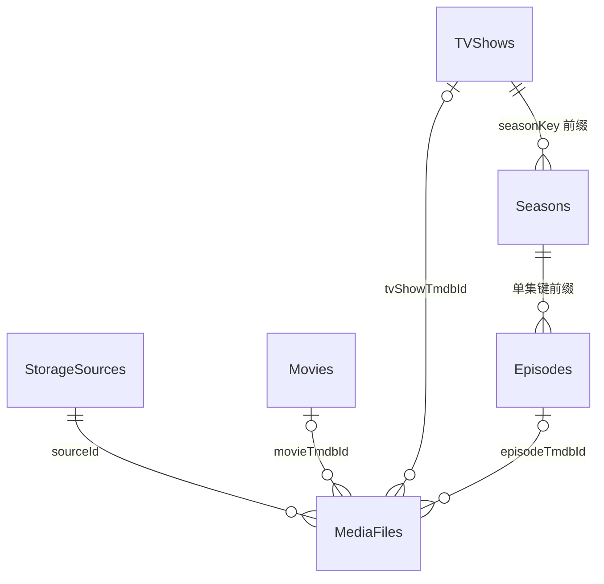
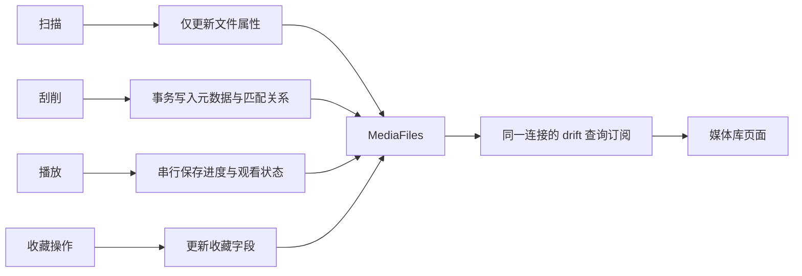

# 数据模型与持久化

核对日期：2026-10-14。本文描述当前 schema 与读写语义；选型及迁移边界见 [ADR 0003](../decisions/0003-persistence-migration.md)，规则与算法见 [算法说明](algorithms.md)。

## 存储分工

| 数据 | 存放位置 | 所有权 |
| --- | --- | --- |
| 媒体文件、元数据、进度、收藏、媒体源 | drift + SQLite：应用文档目录的 `mochi_player.sqlite` | 应用共享数据库 |
| 应用设置、主题、语言偏好 | SharedPreferences | 共享设置 / 主题 / 语言控制器 |
| TMDB 图片 | flutter_cache_manager 文件缓存，30 天过期、上限 1200 条 | 图片缓存服务 |

[AppDatabase](../../lib/core/infrastructure/database/app_database.dart) 定义表，`DatabaseService` 管理连接与写入，`LibraryRepository` 提供读取投影。生产连接使用 `NativeDatabase.createInBackground`；主视图与播放器共用同一个后台 SQLite 连接，播放器关闭不关闭数据库，应用退出统一关闭。

## 表、身份与逻辑关联

| 表定义 | 主键 / 业务唯一键 | 内容 |
| --- | --- | --- |
| `MediaFiles` | 自增 `id`；`storageKey = sourceId:path` 唯一 | 实际文件、解析属性、元数据关联、技术信息、进度与收藏 |
| `Movies` | `tmdbId` 主键 | 电影标题、图片、日期、简介、评分、类型与演员 |
| `TVShows` | `tmdbId` 主键 | 剧集元数据、状态与季集数量 |
| `Seasons` | `seasonKey` 主键，如 `123_s1` | 季号、标题、图片、简介 |
| `Episodes` | `tmdbId` 主键，如 `123_s1e1` | 集号、标题、日期、剧照、客串演员 |
| `StorageSources` | 自增 `id`；`sourceId` 唯一 | 类型、名称、地址、根路径、启用状态与凭据 |

`Episodes.tmdbId` 当前是项目构造的“剧集 ID + 季号 + 集号”，不是 TMDB 返回的单集数字 ID。详情查询通过季 / 集键的前缀约定建立关联。以下是业务逻辑关系，**没有声明 SQL 外键**，不能把图中的关系当作数据库强制约束：



一个逻辑标题可以对应多个实际文件，例如同一电影的不同来源、分辨率或编码版本。文件进度与收藏存于 `MediaFiles`；标题级收藏操作批量修改该标题下的文件，尚无独立收藏表。

文件字段分别保存显式 ID、电影 ID、所属剧集 ID、单集键与匹配状态。领域属性 `MediaFile.tmdbId` 为可直接播放项的派生 ID：电影取电影 ID，单集取单集键；所属剧集用 `tvShowTmdbId`。

## 映射、字段编码与索引

- drift `@UseRowClass` 直接构造不可变领域模型，生成 `toInsertable()`；媒体源使用生成的 `StorageSourceRow` 经服务转换。
- 类型、演员和客串演员列表由 [JSON 转换器](../../lib/core/infrastructure/database/json_converters.dart) 存为 TEXT，不是关联表。当前满足展示，复杂的按演员 / 类型查询仍需评估。
- 枚举存名称；日期按 [build.yaml](../../build.yaml) 配置存 ISO 文本以保留微秒精度。播放位置和时长以毫秒存储。
- `MediaFiles` 有来源、显式 ID、电影 / 剧集 / 单集关联、观看状态、最近观看时间、收藏、添加时间等单列索引，以及业务键唯一索引。
- `PRAGMA foreign_keys=ON` 为连接配置，但当前 schema 未声明关联外键，引用完整性主要由应用事务保证。

## 写入边界



- 扫描按 128 个文件分批 batch upsert，保留已有行 ID、添加时间、用户进度和收藏；媒体类型变化时清空不兼容的匹配关系。
- 扫描成功才删除本来源未再出现的文件；目录读取失败或应用退出中断扫描时跳过删除，成功发现的文件仍保存。
- 元数据与文件匹配在事务内提交；季集导入使用 batch。
- 进度裁剪到合法范围，可选更新时长并记录 UTC 观看时间；位置为 0 为未开始，达到时长 95% 为已完成，其余为观看中。
- 进度与收藏各自局部 UPDATE，旧扫描 / 刮削快照不会覆盖它们。
- 删除来源同时删除所属文件，保留共享元数据；`clearLibrary` 清空库数据但保留媒体源配置。

## 读取、订阅与容量边界

SQL 完成列表搜索、排序、收藏去重和每标题续播目标选择，再返回有限投影。首页保留 15 条最近添加、15 条续播和 1 条 Hero；详情、版本与队列按相关标题读取，不加载完整元数据 Catalog。

网格初始 `LIMIT 100`，滚动时增大 100 再读取前 N 条，属于扩展结果窗口，**不是 OFFSET 或游标分页**。搜索通过自定义确定性函数 `library_normalize` 与 `instr` 计算匹配；不是 FTS 全文检索。大库性能需要查询计划和容量测试，已有单列索引不代表所有过滤和排序都能利用索引。

播放器写入与媒体库查询使用同一 drift 连接，订阅直接刷新，不回传变更键、不手动失效。双独立连接只用于并发 / 持久化测试；未来若引入独立连接，需重新设计通知边界。

## 连接、schema 与凭据

[sqlite_setup.dart](../../lib/core/infrastructure/database/sqlite_setup.dart) 启用 WAL、5 秒 busy timeout 并注册 `library_normalize`；首次切换 WAL 锁竞争限时重试。首次建表在 `BEGIN IMMEDIATE` 写锁内复查 `user_version` 并原子提交。生产共享连接仍保留这些并发安全措施。

项目尚无 Release；Isar 替换建立新库，不读取、导入或删除旧 Isar 文件。当前 schemaVersion 为 1，生成代码与 [schema 快照](../../drift_schemas/) 入库。修改表定义执行：

```bash
fvm dart run build_runner build
fvm dart run drift_dev schema dump lib/core/infrastructure/database/app_database.dart drift_schemas/
```

后续 SQLite schema 变化需提升版本并补迁移策略 / 测试，不能把“不保留旧 Isar 开发数据”推广为任意版本都不需要迁移。

媒体源用户名 / 密码当前是 SQLite 普通文本，尚未接入系统凭据存储。语言偏好由共享 `AppLocaleController` 保存为 SharedPreferences 的 `app_language`（`system / zh / en`），不写 SQLite，也不使用跨窗口快照。主题和播放器设置由各自服务保存。

## 待完善

- 无引用元数据回收、必要的引用约束及凭据存储。
- 大库搜索、扩展 LIMIT 与索引的实测容量基线。
- TMDB 网络错误与搜索未命中的区分，避免失败匹配破坏已有关系。
- 95% 完成阈值目前在多处定义，调整时应同步数据库与续播规则。

数据层自动化验证唯一键、JSON、日期、事务、局部更新、两连接并发与关闭重开；自动化与真实媒体 / 平台验证分别记录在 [测试指南](../guides/testing.md)。
