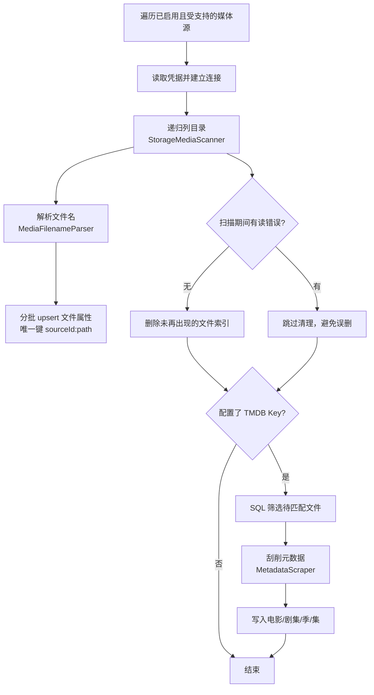

# 媒体流水线：扫描 → 解析 → 刮削 → 索引

核对日期：2026-10-26。本文描述从「配置媒体源」到「首页出现海报」的完整链路。入口是
[LibrarySyncService.scanEnabledMediaSources()](../../lib/features/library/sync/application/library_sync_service.dart)。

字段所有权与订阅见 [数据模型](data-model.md)，复杂度、排序与调度策略见 [算法说明](algorithms.md)。

## 阶段 1：扫描与入库

- `StorageLibrarySourceScanner.enabledSources()` 返回 `enabled == true` 且注册表支持其类型的媒体源；同步编排仅依赖 `LibrarySourceScanner` 契约。
- `StorageLibrarySourceScanner.open()` 在内部读取凭据，经注册表建立本地 / WebDAV / SMB 连接并返回 `LibrarySourceScanSession`。同步服务在 finally 关闭会话；会话关闭幂等。退出期间迟到的会话直接关闭，不启动扫描；已知路径查询返回后也会复查退出状态，禁止启动目录读取；退出等待已接受任务收尾。
- `StorageMediaScanner.scan()` 递归列目录，过程中任何一次目录读取失败都会置位「读错误」，从而**跳过失效文件清理**——宁可留下失效记录，也不误删整个来源（网络抖动场景）。
- 视频判定依赖扩展名白名单（[media_file_kind.dart](../../lib/features/library/domain/media_file_kind.dart)）：`mp4 mkv avi mov wmv flv webm ts m2ts mpg mpeg m4v`。
- **幂等键**：数据库使用 `(sourceId, path)` 组合唯一约束；派生 `storageKey` 仅用于任务集合。新路径插入，已有路径仅更新大小与解析属性，保留匹配、进度、收藏与添加时间。
- 清理：扫描成功时，删除属于该来源但本次未出现的记录。
- `LibrarySyncRepository` 由 `LibrarySyncRepositoryImpl` 实现，负责已知路径、扫描文件写入、失效清理和候选查询，与展示查询仓库分开。扫描过程中按 128 个文件分批写入；扫描结束后，若配置了 TMDB，SQL 筛选缺少元数据或显式数字 ID 覆盖原匹配的文件，再进入刮削。写入失败中止该来源，不在收尾阶段隐式重试；来源完整扫描和关闭均成功才计入成功，避免重复计数；关闭失败不丢弃已完成入库 / 清理的文件数量。运行中的任务不允许通过状态重置绕过互斥。

## 阶段 2：文件名解析

[MediaFilenameParser.parse()](../../lib/features/library/sync/domain/media_filename_parser.dart) 从文件名（必要时回退到路径）提取：

| 类别 | 规则示例 |
| --- | --- |
| 季集（合并写法） | `S01E05`、`Season 1 Episode 5` |
| 仅季 | `S01`、`第X季` |
| 仅集 | `E01`、`EP01`、`第X集` / `第X话`；纯数字仅在整名即为数字时生效 |
| 季号继承 | 季号可来自父目录；只有集号时推断为第 1 季 |
| 显式 TMDB ID | `{tmdbid-12345}` / `{tmdb-12345}` |
| 年份 | 1900–2100，需带分隔符；结尾年份由路径兜底 |
| 技术信息 | 分辨率 → `height`（720p/1080p/2160p/4k/uhd）、视频编码（h264/hevc/av1 等）、音频编码（含 `DDP5.1` 内嵌声道）、声道（2.0/5.1/7.1/stereo/mono）、HDR（hdr10/hdr10+/dolby vision/dv/hlg）、来源（BluRay/WEB-DL 等） |
| 版本标签 | 由上述技术信息合成 `versionLabel`，用于同片多版本区分 |

标题清洗包含：HTML 实体解码、去掉站点前缀与「导演剪辑版 / 加长版 / 修复版 / 周年纪念版」等后缀、剔除分辨率标记与年份、通用名黑名单。解析结果经 `ScannedMediaFileMapper` 生成不可变文件快照。

多版本文件**不合并**：同一电影或剧下的多个文件由带标题类型的查询接口聚合（`getVersions(LibraryItem)`），详情页按分辨率与体积排序供用户选择；电影与剧的相同数字 ID 相互隔离。

## 阶段 3：TMDB 刮削

[MetadataScraper](../../lib/features/library/metadata/application/metadata_scraper.dart) 与
[MetadataMatcher](../../lib/features/library/metadata/application/metadata_matcher.dart)：

1. 用 SQL EXISTS 筛选缺少元数据或显式 ID 发生变化的文件；没有候选时不发请求。
2. `ScrapeSearchPlan.forCandidate` 构造查询，`MetadataMatcher` 匹配目标；搜索顺序、剧集分组与并发限制见 [算法说明](algorithms.md#刮削计划与有界并发)。
3. 编排通过 `MetadataSource` 获取元数据；`TmdbMetadataSource` 使用共享 `TmdbApi` 请求详情（电影附带 `credits,release_dates,images`，剧集使用对应参数；`language=zh-CN`），`TmdbMetadataMapper` 转为领域模型。
4. `MetadataRepository` 由 `MetadataRepositoryImpl` 实现，原子写入元数据与文件关联；季集通过共享领域值 `SeasonMetadata` 传递，集 ID 形如 `show_s1e1`。任务回调报告完成数、总数、成功 / 失败与当前标题。部分季已提交后其他持久化步骤失败时，已确认文件仍计为成功，每个文件仅统计一次。
5. 成功查询后无候选或详情 / 季不存在（404）时，标记未匹配并清空对应 ID。请求失败不属于未匹配，不修改受影响文件的匹配状态、原有 ID、进度或收藏。

### 请求失败与未匹配

`TmdbHttpClient.get` 仅在资源不存在（404）时返回 `null`；成功的空搜索结果由 `TmdbApi` 转为无匹配。搜索 / 趋势列表接口本身返回 404 时属于响应异常，不能解释为空列表；只有电影 / 剧集 / 季详情的资源 404 可以作为缺失元数据。未配置凭据、401 / 403、429、超时、连接 / 证书错误、取消、5xx 及响应结构异常通过 `TmdbFailure` 传递；其中保留错误类别、HTTP 状态与可解析的 `Retry-After`，不携带 API Key 或原始请求异常。搜索列表缺少 `results` 或列表元素类型非法时视为响应异常，不能解释为空搜索。

请求失败立即中断当前匹配，不继续执行不带年份等回退查询。电影 / 剧集详情失败时保留原关联；季详情失败仅影响该季，其他季继续，失败季的文件不会进入未匹配清理。已成功导入的季保留成功计数，真正缺失的季 / 单集按未匹配处理。

`TmdbMetadataSource` 将传输层 `TmdbFailure` 转为应用契约的 `MetadataRequestFailure`，保留语义提示、重试属性、HTTP 状态与重试等待时间。`ScrapeResult` / `ScrapeProgress` 位于应用层，`ScrapeResult.requestFailures` 将请求错误保留给同步应用入口，失败文件仍计入失败数；`LibrarySyncService` 使用首个请求错误生成语义化界面提示。扫描结果与 TMDB 连接测试区分认证、限流、超时、网络及服务 / 响应异常。首页趋势调用捕获失败，保留已有内容。当前没有自动重试、退避或批次暂停；恢复网络 / 修正配置后可以重新扫描，待匹配查询仍会选出缺少元数据或显式 ID 覆盖尚未完成的文件。

网络与代理：`TmdbHttpClient` 统一处理 API Key、语言、超时与代理（`PROXY host:port`，不支持代理认证），图片走 `TmdbImageCacheManager`（30 天、1200 条上限，使用相同代理）。

## 阶段 4：索引与展示

| 能力 | 实现位置 | 说明 |
| --- | --- | --- |
| 查询投影 | [library_catalog_repository_impl.dart](../../lib/features/library/catalog/data/library_catalog_repository_impl.dart) | SQL 电影、剧集、收藏、续看、多版本与队列查询 |
| 订阅与分页 | [library_query_view.dart](../../lib/features/library/ui/widgets/library_query_view.dart) | 页面维持稳定查询订阅，网格按需扩展 LIMIT |
| 继续观看 | [library_catalog_repository_impl.dart](../../lib/features/library/catalog/data/library_catalog_repository_impl.dart) | SQL 先选每标题续播目标再分页；用领域 Resolver 测试验证策略一致性 |
| 搜索 | [library_search_text.dart](../../lib/core/domain/media/library_search_text.dart) | 小写并移除指定空格 / 分隔符；评分与排序见 [算法说明](algorithms.md#本地搜索评分) |
| 收藏 | [media_library_provider.dart](../../lib/features/library/application/media_library_provider.dart) | 标题级批量切换，作用于该标题下全部版本 |

## 已知问题

| 问题 | 影响 |
| --- | --- |
| 无元数据回收 | 删除文件后电影/剧集/季/集残留 |
| 分组与标题归一化逻辑多处重复 | 修改规则需同步多个实现 |

处置见 [0003 持久化](../decisions/0003-persistence-migration.md)。

## 候选与编排维护边界

`ScrapeCandidate` 引用不可变 `MediaFile`，从中读取标题、季集号和关联 ID，并解析显式数字 ID。

`LibrarySyncService` 的入口按读取启用来源、逐来源扫描、可选元数据刮削和汇总结果执行。逐来源的批次、错误隔离及计数在 `_scanSources` 维护；`_scanSource` 在 finally 关闭连接。完整扫描后清理旧索引，写入失败终止当前来源，退出时等待已接受任务完成。
