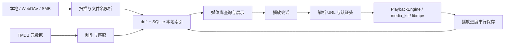
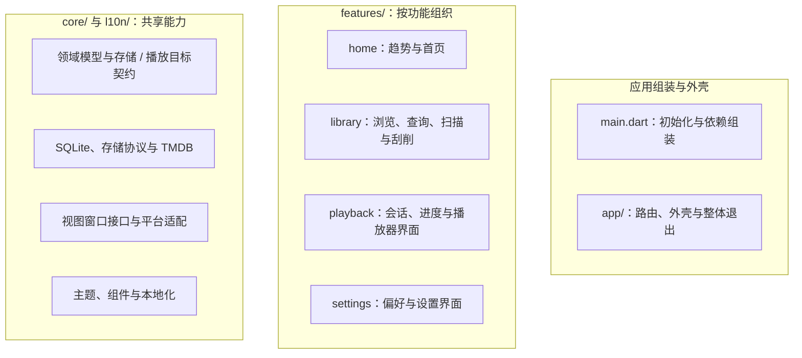
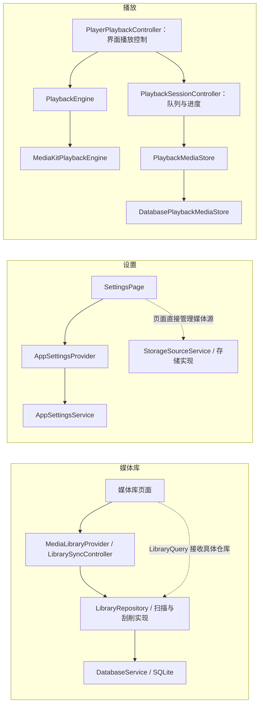

# 架构总览

本文描述当前实现（核对日期：2026-10-14）。功能完成度见 [实施状态](../status.md)，技术取舍见 [ADR](../decisions/)，验证证据见 [测试指南](../guides/testing.md)。

## 系统边界

Mochi Player 是面向 macOS / Windows 的本地优先桌面媒体库播放器。文件系统媒体源包括本地、WebDAV 和 SMB；扫描与 TMDB 刮削形成本地索引，播放器使用 libmpv（经 media_kit）。SMB 可浏览 / 扫描，但当前捆绑播放器不能直接打开或 seek SMB URL；HTTP 回源和媒体服务器接入仍是计划。

这张图表示数据流，不表示各模块直接互相导入。

## 代码分层与依赖

| 目录 | 职责 | 主要入口 |
| --- | --- | --- |
| `app/` | 路由、应用外壳、整体退出 | `app/routing/`、`app/application/` |
| `core/domain/` | 共享领域模型、存储 / 播放目标接口、续播规则 | `media/`、`storage/`、`playback/` |
| `core/infrastructure/` | SQLite、存储协议、TMDB 实现 | `database/`、`storage/`、`tmdb/` |
| `core/platform/` | 视图级窗口接口及平台适配 | `WindowService`、`DesktopWindowHost` |
| `core/ui/` | 主题、组件、展示格式 | `app_ui.dart` |
| `features/` | 首页、媒体库、播放、设置的应用逻辑与界面 | 各功能的 `application / domain / infrastructure / presentation` |
| `l10n/` | 英文模板、中文译文、共享语言控制器 | `app_en.arb`、`app_zh.arb` |
| `main.dart` | 初始化并组装共享依赖、主窗口及播放器工厂 | [启动入口](../../lib/main.dart) |

项目采用按功能组织的分层模块化单体：首页、媒体库、播放和设置各自组织页面与应用逻辑，共用存储、数据库、平台和 UI 能力。这里的分层是职责划分，尚未形成所有上层只依赖接口的严格依赖约束。

### 各层职责

展示层处理用户交互，应用层编排业务用例，基础设施层提供持久化与外部能力。各层的当前实现如下：

| 职责 | 当前项目的代码 | 实际边界 |
| --- | --- | --- |
| 展示与交互 | `presentation/` 页面、组件与界面控制器 | 接收点击 / 输入，渲染状态与错误；处理窗口交互与视频表面 |
| 应用用例与状态协调 | [MediaLibraryProvider](../../lib/features/library/application/media_library_provider.dart)、[LibrarySyncController](../../lib/features/library/application/library_sync_controller.dart)、[AppSettingsProvider](../../lib/features/settings/application/app_settings_provider.dart)、[PlaybackSessionController](../../lib/features/playback/application/playback_session_controller.dart) | 协调扫描、刮削、偏好保存、播放队列和进度；Provider 同时负责界面状态通知 |
| 持久化访问 | [LibraryRepository](../../lib/features/library/infrastructure/library_repository.dart)、[DatabaseService](../../lib/core/infrastructure/database/database_service.dart)、[DatabaseStorageSourceRepository](../../lib/core/infrastructure/storage/storage_source_repository.dart) | SQL 查询 / 订阅、字段级写入、事务与媒体源存储 |
| 持久化框架与映射实现 | [AppDatabase](../../lib/core/infrastructure/database/app_database.dart)、[media_tables.drift](../../lib/core/infrastructure/database/media_tables.drift)、`app_database.g.dart` | drift 表定义、约束、Companion、模型映射与生成的数据库代码；生成文件不手工修改 |
| 业务模型与结果对象 | `core/domain/media/`、`features/*/domain/`、[MediaCardViewData](../../lib/features/library/application/media_card_view_data.dart) | 领域模型和页面投影；当前部分领域模型直接作为 drift 行模型，没有独立 Entity → Domain 转换层 |

`DatabaseService` 位于基础设施层，是共享数据库连接与多表持久化写入边界。`StorageSourceService` 是媒体源仓库的薄协调入口，位于 `core/infrastructure/storage/`。职责由实现与依赖决定，不由类名中的 `Service` 决定。

常规业务方向是“展示交互 → 应用用例 → 数据访问 / 外部能力适配”。应用入口按业务用例组织，持久化访问按读写职责组织；例如扫描媒体库涉及来源、文件与元数据，不与单张表绑定。drift 提供映射与查询能力，任务编排由应用逻辑负责。

当前职责分离仍有例外：界面读查询公开具体仓库，部分页面直接管理存储；`MetadataScraper` 与 `MetadataImporter` 等位于基础设施目录的类也承担匹配 / 导入协调。下面分别记录当前路径与整改建议，目录归属不代表依赖边界已全部收拢。

### 模块职责

下图只表示目录归属，不表示调用或导入。各功能按需要设置子目录，并非每个功能都有完整的四层。

`core/` 不导入 `features/`。功能之间仍有协作，例如设置变更影响媒体库和趋势；目录归属不代表模块完全独立。

### 业务调用与当前越层访问

下图表示代表性的调用路径，不是完整 import 图。实线为当前常规路径，虚线为需要收拢的页面直接访问。入口组装、图片缓存和窗口操作不混入这张业务图。

播放路径中“契约 → 运行时实现”表示方法调用最终落到适配器，不表示接口文件导入实现。`PlaybackSessionController` 不调用播放引擎；真正的 open / seek 与状态流绑定由展示目录中的 `PlayerPlaybackController` 负责。模型和接口被各层使用，省略这些普遍依赖，避免把领域层画成所有箭头的终点。

### 可沿代码追踪的业务路径

| 操作 | 当前调用路径 | 需要注意的边界 |
| --- | --- | --- |
| 扫描媒体库 | `SettingsPage` → `MediaLibraryProvider.scanMediaSources()` → `LibrarySyncController.scanEnabledMediaSources()` → 存储连接 / `StorageMediaScanner` → `DatabaseService.saveScannedFiles()` | 应用控制器负责批次、取消、错误与清理；SQL 文件写入后，库查询订阅刷新；配置了 TMDB 时后续进行刮削 |
| 收藏标题 | `FavoriteButton` → `MediaLibraryProvider.setFavorite(LibraryItem)` → `DatabaseService.setTitleFavorite()` | 应用层目前是薄转发；数据层按标题类型批量更新文件，页面通过 `LibraryQuery` 直接订阅具体仓库 |
| 查询详情 | `MediaDetailPage` → `LibraryQuery` → `MediaLibraryProvider.repository` → `LibraryRepository.watchDetail()` / `watchVersions()` | 这是当前存在的读侧越层路径，不是已封装好的应用查询接口 |
| 保存播放进度 | `PlayerPlaybackController` → `PlaybackSessionController` → `PlaybackProgressWriter` → `PlaybackMediaStore` → `DatabasePlaybackMediaStore` → `DatabaseService.updateProgress()` | 定时与关闭时提交；串行写入局部字段；数据库适配当前仍与契约同处应用目录 |
| 保存普通偏好 | `SettingsPage` → `AppSettingsProvider.saveSettings()` → `AppSettingsService` | 保存到 SharedPreferences；媒体源编辑走另一条直接存储服务路径，不写成全部设置都经同一应用入口 |

扫描 / 刮削的具体步骤见 [媒体流水线](media-pipeline.md)，播放的关闭与保存顺序见 [播放](playback.md)，SQL 映射与写入边界见 [数据模型](data-model.md)。

以下依赖有明确用途，不应仅因跨目录就判为架构问题：

- 入口和工厂必须选择具体实现并组装依赖；需要明确它们的组装职责。
- 页面使用 `core/ui` 和视图级 `WindowService` 属于展示与窗口交互。
- 图片组件使用 TMDB 图片缓存属于展示资源加载，与页面直接处理存储业务的风险不同。
- 应用服务调用具体仓库是当前务实分层的取舍；是否引入接口应由替换、测试与职责边界决定。

库查询返回有限的页面投影，不再由全量内存 Catalog 承担筛选与聚合。UI 包独立迁移尚未进行，旧 Material/Cupertino 导入的弃用提示仍可见。

### 已识别的架构问题

以下是当前代码问题及后续建议，整改尚未实施；不把建议中的边界当作现状。

| 问题与代码证据 | 当前影响 | 建议整改与完成标准 |
| --- | --- | --- |
| [SettingsPage](../../lib/features/settings/presentation/pages/settings_page.dart) 创建 `StorageSourceService`，直接引用 SMB 与存储注册表；[FileBrowserPage](../../lib/features/library/presentation/pages/file_browser_page.dart) 也直接使用媒体源服务 | 页面承担媒体源业务协调，错误、任务状态与刷新逻辑容易分散 | 优先把媒体源操作收拢到应用层；页面保留输入、确认与展示，不直接编排存储实现 |
| [MediaLibraryProvider](../../lib/features/library/application/media_library_provider.dart) 公开具体 `repository`；[LibraryQuery](../../lib/features/library/presentation/widgets/library_query.dart) 接收 `LibraryRepository` 回调 | 页面查询与仓库 API 绑定，Provider 未形成完整的查询边界 | 再收拢页面使用的查询入口与投影；页面不再依赖具体仓库类型，保留 drift 订阅刷新行为 |
| [playback_media_store.dart](../../lib/features/playback/application/playback_media_store.dart) 同时定义 `PlaybackMediaStore` 和 `DatabasePlaybackMediaStore` | 引用契约也会引入数据库实现所在文件，应用契约与适配职责混合 | 将数据库适配移入 `infrastructure/`；契约所在文件不导入数据库实现 |
| [player_window_app.dart](../../lib/features/playback/presentation/player_window_app.dart) 同时负责界面、窗口生命周期与具体播放后端组装 | 播放器展示入口包含较多组装职责，替换后端时需要修改展示目录 | 明确独立的播放器组装入口，注入后端工厂；保持窗口关闭、换片和资源释放顺序 |
| 数据库与 TMDB 存在单例及默认构造；应用对象内部仍选择具体服务 | 依赖来源部分隐含，隔离测试和替换实现需要额外处理 | 最后按实际需求集中关键依赖组装；避免给每个类机械增加接口 |

建议顺序为：页面业务收拢 → 查询边界收拢 → 适配器归位与播放器组装分离 → 关键依赖显式注入。整改应维持现有功能和生命周期契约，并验证相关行为；仅调整目录名或补接口不能视为问题已解决。

后续按业务用例收拢应用入口、按查询 / 写入职责划分持久化访问，不要求每次调用都有三层转发，也不要求给每张表增加独立 DAO。当前 `DatabaseService` 管理多表写入，`LibraryRepository` 提供媒体库读取；这是现状，尚未拆成每个实体的仓库。

## 运行时：一个引擎、两个视图、一个共享数据库连接

本图箭头表示创建 / 管理关系，省略业务调用。两个视图使用同一组应用共享对象；没有分别持有独立数据库连接。

原生 runner 创建一个引擎并注册一次插件；Dart 创建窗口。数据库通过后台 isolate 执行，UI 与播放器共享同一连接对象；数据库后台 isolate 不等于第二个播放器引擎。

| 所有者 | 状态 / 资源 | 释放时机 |
| --- | --- | --- |
| 应用 | `PlayerWindowCoordinator`、设置、主题、语言、库任务与数据库 | 主窗口关闭 / 应用退出 |
| 每个视图 | `WindowService`、`WindowControlsController`、消息队列 | 对应视图退役 |
| 播放会话 | `PlaybackEngine`、播放队列、进度写入与窗口模式控制器 | 换片或播放器关闭 |

共享 Provider 包括媒体库、文件浏览、趋势、设置、主题与 `AppLocaleController`；窗口接口和消息宿主按视图注入。`AppMessage` 通过调用方 context 找到消息宿主，不通过全局变量猜测窗口。

## 核心契约

| 契约 | 当前实现与边界 |
| --- | --- |
| [StorageProvider / StorageConnection](../../lib/core/domain/storage/storage_provider.dart) | 注册表按协议建立连接与列目录；浏览能力与播放协议能力分别验证 |
| [PlaybackTargetResolver](../../lib/core/domain/playback/playback_target_resolver.dart) | 根据媒体源解析 URL 与请求头，不负责媒体服务器的会话上报 |
| [PlaybackEngine](../../lib/features/playback/application/playback_engine.dart) | 播放、seek、轨道、选项、状态流及视频表面；不暴露任意 mpv 属性 API |
| [DatabaseService](../../lib/core/infrastructure/database/database_service.dart) | 共享连接、事务与字段级写入 |
| [LibraryRepository](../../lib/features/library/infrastructure/library_repository.dart) | SQL 筛选、聚合、有限结果投影与 drift 订阅 |
| [WindowService](../../lib/core/platform/window_service.dart) | 所属视图的窗口操作；原生桥每次带 `viewId` |

## 生命周期与同步

主窗口关闭意味着整个程序退出：先拒绝新任务，保存 / 释放播放器，再收尾应用任务与偏好、关闭数据库，最后结束进程。单独关闭播放器保留主窗口与数据库。失败或无响应经过有界等待后继续退出，不承诺超时场景一定保存最后快照。详细顺序见 [播放生命周期](playback.md#生命周期与退出)。

数据库变更由共享连接的 drift 订阅刷新媒体库；语言、主题与设置由共享 Provider 通知。不再使用窗口 RPC、版本化 JSON 启动协议、语言快照或跨连接手动查询失效。小窗采用 mini，系统画中画暂不纳入计划。

## 当前设计限制

- 部分上层依赖具体实现，数据库和 TMDB 服务仍使用单例；接口化按实际替换 / 测试需求推进。
- 单个 UI isolate 中的同步重任务会影响两个视图；数据库已移到后台，但不能据此宣称所有计算都已隔离。
- 实验窗口 API 与固定 main SDK 需要持续验证插件、原生交互和发布。
- 大库分页、搜索与索引效果尚无容量基线；不把实现了 SQL 等同于性能已验证。
- 元数据匹配错误分类、凭据存储和元数据回收仍待完善，见 [数据模型](data-model.md) 与 [媒体流水线](media-pipeline.md)。
