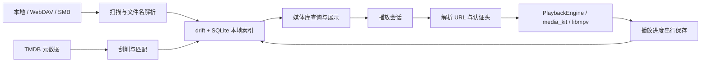
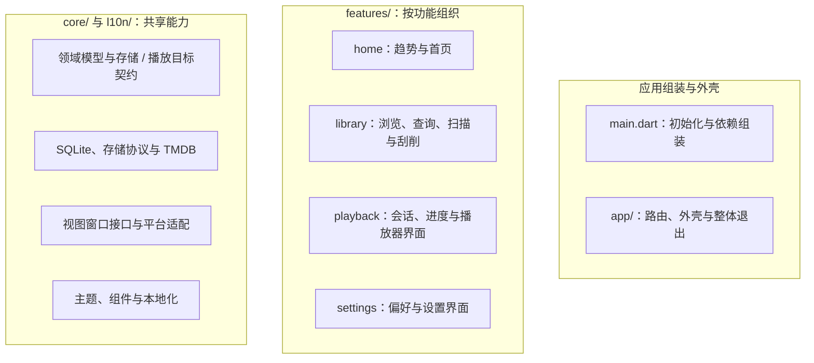
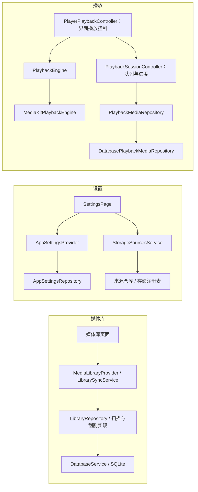
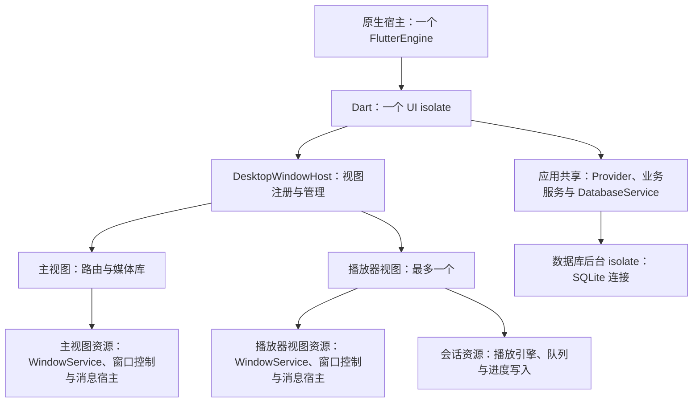

# 架构总览

本文描述当前实现（核对日期：2026-10-14）。功能完成度见 [实施状态](../status.md)，技术取舍见 [ADR](../decisions/)，验证证据见 [测试指南](../guides/testing.md)。

## 系统边界

Mochi Player 是面向 macOS / Windows 的本地优先桌面媒体库播放器。文件系统媒体源包括本地、WebDAV 和 SMB；扫描与 TMDB 刮削形成本地索引，播放器使用 libmpv（经 media_kit）。SMB 可浏览 / 扫描，但当前捆绑播放器不能直接打开或 seek SMB URL；HTTP 回源和媒体服务器接入仍是计划。

这张图表示数据流，不表示各模块直接互相导入。

## 代码分层与依赖

| 目录 | 职责 | 主要入口 |
| --- | --- | --- |
| `app/` | 依赖组装、路由、应用外壳、整体退出 | `app/bootstrap/`、`app/routing/`、`app/application/` |
| `core/domain/` | 共享领域模型、存储 / 播放目标接口、续播规则 | `media/`、`storage/`、`playback/` |
| `core/infrastructure/` | SQLite、存储协议、TMDB 实现 | `database/`、`storage/`、`tmdb/` |
| `core/platform/` | 视图级窗口接口及平台适配 | `WindowService`、`DesktopWindowHost` |
| `core/ui/` | 主题、组件、展示格式 | `app_ui.dart` |
| `features/` | 首页、媒体库、播放、设置的应用逻辑与界面 | 各功能的 `application / domain / infrastructure / presentation` |
| `l10n/` | 英文模板、中文译文、共享语言 Provider | `app_en.arb`、`app_zh.arb` |
| `main.dart` | 初始化并组装共享依赖、主窗口及播放器工厂 | [启动入口](../../lib/main.dart) |

项目采用按功能组织的分层模块化单体：首页、媒体库、播放和设置各自组织页面与应用逻辑，共用存储、数据库、平台和 UI 能力。这里的分层是职责划分，尚未形成所有上层只依赖接口的严格依赖约束。

### 各层职责

展示层处理用户交互，应用层编排业务用例，基础设施层提供持久化与外部能力。各层的当前实现如下：

| 职责 | 当前项目的代码 | 实际边界 |
| --- | --- | --- |
| 展示与交互 | `presentation/` 页面、组件与界面控制器 | 接收点击 / 输入，渲染状态与错误；处理窗口交互与视频表面 |
| 应用用例与状态协调 | [MediaLibraryProvider](../../lib/features/library/application/media_library_provider.dart)、[LibrarySyncService](../../lib/features/library/application/library_sync_service.dart)、[AppSettingsProvider](../../lib/features/settings/application/app_settings_provider.dart)、[PlaybackSessionController](../../lib/features/playback/application/playback_session_controller.dart) | Provider 暴露界面数据与状态；Service 编排扫描 / 刮削；播放会话 Controller 控制队列与进度操作 |
| 持久化访问 | [LibraryRepository](../../lib/features/library/infrastructure/library_repository.dart)、[DatabaseService](../../lib/core/infrastructure/database/database_service.dart)、[DatabaseStorageSourceRepository](../../lib/core/infrastructure/storage/storage_source_repository.dart) | SQL 查询 / 订阅、字段级写入、事务与媒体源存储 |
| 持久化框架与映射实现 | [AppDatabase](../../lib/core/infrastructure/database/app_database.dart)、[media_tables.drift](../../lib/core/infrastructure/database/media_tables.drift)、`app_database.g.dart` | drift 表定义、约束、Companion、模型映射与生成的数据库代码；生成文件不手工修改 |
| 业务模型与结果对象 | `core/domain/media/`、`features/*/domain/`、[MediaCardViewData](../../lib/features/library/application/media_card_view_data.dart) | 领域模型和页面投影；当前部分领域模型直接作为 drift 行模型，没有独立 Entity → Domain 转换层 |

`DatabaseService` 位于基础设施层，是共享数据库连接与多表持久化写入边界。[StorageSourcesService](../../lib/features/library/application/storage_sources_service.dart) 位于应用层，负责媒体源配置、连接测试、删除后的浏览选择清理及退出时任务收尾。职责由实现与依赖决定，不由类名中的 `Service` 决定。

常规业务方向是“展示交互 → 应用用例 → 数据访问 / 外部能力适配”。应用入口按业务用例组织，持久化访问按读写职责组织；例如扫描媒体库涉及来源、文件与元数据，不与单张表绑定。drift 提供映射与查询能力，任务编排由应用逻辑负责。

页面通过应用入口查询和操作，不持有具体数据库仓库或创建存储协议连接。应用层仍依赖部分具体仓库与服务；`MetadataScraper` 与 `MetadataImporter` 等基础设施类也承担匹配 / 导入协调。当前没有把所有上层依赖改成接口，不能将这次职责收拢描述为严格 Clean Architecture。

[ApplicationDependencies](../../lib/app/bootstrap/application_dependencies.dart) 集中组装共享数据库、TMDB、来源仓库、协议注册表、扫描 / 刮削服务和界面 Provider。`main.dart` 显式创建数据库、TMDB 与设置服务，初始化后注入应用；这些服务没有隐藏的单例获取路径。页面、扫描与播放使用同一个数据库服务，设置和趋势使用同一个 TMDB 服务。播放器工厂接收后端工厂、存储门面和目标解析器，不自行选择数据库或媒体后端。

### 命名约定

同一类职责使用同一后缀，文件名使用与主要公开类型对应的 `snake_case`。后缀表达职责，不表达注入方式，也不保证所在层或实例作用域：

| 后缀 | 职责与使用范围 | 当前示例 |
| --- | --- | --- |
| `Provider` | 维护界面可订阅状态、加载展示数据并提供界面操作入口 | `MediaLibraryProvider`、`FileBrowserProvider`、`TrendingMediaProvider`、`AppSettingsProvider`、`ThemeProvider`、`AppLocaleProvider` |
| `Controller` | 控制具体交互、播放会话或窗口状态机 | `PlayerPlaybackController`、`PlaybackSessionController`、`PlayerWindowModeController`、`PlayerWindowController`、`WindowControlsController` |
| `Repository` | 持久化业务数据的查询、保存与订阅；接口可只暴露调用方需要的操作 | `LibraryRepository`、`PlaybackMediaRepository`、`AppSettingsRepository` |
| `Service` | 编排业务用例，或提供职责明确的技术能力；通过名称与所在层区分 | 应用层 `LibrarySyncService`、`StorageSourcesService`；技术服务 `TmdbService`、`WindowService`、`DatabaseService` |
| `Adapter` | 将协议或外部能力适配为项目契约 | `StorageAdapter`、`LocalStorageAdapter`、`WebDavStorageAdapter`、`SmbStorageAdapter` |
| `Engine` | 执行播放与管理媒体运行资源的后端边界 | `PlaybackEngine`、`MediaKitPlaybackEngine` |
| `Coordinator` | 协调多个参与者及异步操作顺序，通常不负责页面展示状态 | `PlayerWindowCoordinator`、`ApplicationExitCoordinator`、`PlayerWindowCloseCoordinator` |
| 具体动作 / 数据结构名称 | 职责已经明确时保留具体含义 | `Resolver`、`Scanner`、`Mapper`、`Policy`、`Writer`、`Buffer`、`Registry`、`ViewModel` 等 |

按主要职责选择后缀，不按继承关系机械命名。`ChangeNotifier` 可用于 Provider 的界面状态、Controller 的交互状态，也可用于 Service 的任务进度通知；例如 `LibrarySyncService` 虽会通知扫描进度，主要职责仍是编排扫描与刮削，界面通过 `MediaLibraryProvider` 观察它。

Provider 包的 `Provider`、`ChangeNotifierProvider`、`MultiProvider` 是注入机制，不决定业务对象的后缀。项目的 `*Provider` 表示界面状态角色，不要求为每个注入对象创建一个 Provider 类。持久化访问统一使用 `Repository`，不混用 `Store`。

`PlaybackState` 等状态快照继续使用 `State`；`PlayerWindowController` 控制播放器视图的打开、关闭与替换状态，保留 Controller。方法名包含 `open / close / beginShutdown` 本身不是选择后缀的依据。`ApplicationDependencies` 是依赖组装入口，不是业务 Service，也不是自动装配容器。

### 依赖作用域与所有权

当前采用手工构造与构造参数注入。生产入口创建一组 `ApplicationDependencies`，其中的 Provider、业务服务、仓库与技术服务在本次应用运行中复用；主视图和播放器使用同一数据库服务，设置、趋势与刮削使用同一 TMDB 服务。这是应用范围内的实例共享，不是类级全局单例；测试可以创建互不共享配置的另一组对象。

Provider 把已创建的实例暴露给组件树，窗口相关能力按视图注入。共享对象使用 `.value` 注入，生命周期由应用入口与退出协调器管理；数据库关闭、浏览连接释放、媒体源任务排空和偏好保存均有显式收尾。没有自动扫描注册、按名称查找依赖、自动装配或框架级 Bean Scope 管理。

### 模块归属图

下图只表示目录归属，不表示调用或导入。各功能按需要设置子目录，并非每个功能都有完整的四层。

`core/` 不导入 `features/`。功能之间仍有协作，例如设置变更影响媒体库和趋势；目录归属不代表模块完全独立。

### 业务调用

下图表示代表性的运行时调用路径，不是完整 import 图。入口组装、图片缓存和窗口操作不混入这张业务图。

播放路径中“契约 → 运行时实现”表示方法调用最终落到适配器，不表示接口文件导入实现。`PlaybackSessionController` 不调用播放引擎；真正的 open / seek 与状态流绑定由展示目录中的 `PlayerPlaybackController` 负责。模型和接口被各层使用，省略这些普遍依赖，避免把领域层画成所有箭头的终点。

### 可沿代码追踪的业务路径

| 操作 | 当前调用路径 | 需要注意的边界 |
| --- | --- | --- |
| 扫描媒体库 | `SettingsPage` → `MediaLibraryProvider.scanMediaSources()` → `LibrarySyncService.scanEnabledMediaSources()` → 存储连接 / `StorageMediaScanner` → `DatabaseService.saveScannedFiles()` | 应用服务负责批次、取消、错误与清理；SQL 文件写入后，库查询订阅刷新；配置了 TMDB 时后续进行刮削 |
| 收藏标题 | `FavoriteButton` → `MediaLibraryProvider.setFavorite(LibraryItem)` → `DatabaseService.setTitleFavorite()` | 数据层按标题类型批量更新文件；页面通过应用查询入口订阅结果，不持有仓库 |
| 查询详情 | `MediaDetailPage` → `LibraryQuery` → `MediaLibraryProvider.watchDetail()` / `watchVersions()` → 私有 `LibraryRepository` | 查询回调接收应用 Provider，内部仓库不公开；保留 drift 查询订阅与扩展 LIMIT |
| 保存播放进度 | `PlayerPlaybackController` → `PlaybackSessionController` → `PlaybackProgressWriter` → `PlaybackMediaRepository` → `DatabasePlaybackMediaRepository` → `DatabaseService.updateProgress()` | 定时与关闭时提交；串行写入局部字段；契约在应用层，数据库适配在基础设施层 |
| 保存普通偏好 | `SettingsPage` → `AppSettingsProvider.saveSettings()` → `AppSettingsRepository` | 保存到 SharedPreferences；媒体源编辑通过 `StorageSourcesService`，与普通偏好入口分别组织 |
| 测试媒体源 | `SettingsPage` → `StorageSourcesService.testConnection()` → 协议注册表 / 连接 | 临时连接无论读取成功或失败均在 finally 释放；退出时拒绝新操作并等待已接受任务 |
| 打开来源浏览 | `FileBrowserPage` → `FileBrowserProvider.openStorageSource()` → 注入的凭据读取方法 / 存储注册表 | 页面不读取凭据后自行连接；切换、清空与关闭时释放连接，迟到连接不会重新选中来源 |

扫描 / 刮削的具体步骤见 [媒体流水线](media-pipeline.md)，播放的关闭与保存顺序见 [播放](playback.md)，SQL 映射与写入边界见 [数据模型](data-model.md)。

以下依赖有明确用途，不应仅因跨目录就判为架构问题：

- 入口和工厂必须选择具体实现并组装依赖；需要明确它们的组装职责。
- 页面使用 `core/ui` 和视图级 `WindowService` 属于展示与窗口交互。
- 图片组件使用 TMDB 图片缓存属于展示资源加载，与页面直接处理存储业务的风险不同。
- 应用服务调用具体仓库是当前务实分层的取舍；是否引入接口应由替换、测试与职责边界决定。

库查询返回有限的页面投影，不再由全量内存 Catalog 承担筛选与聚合。UI 包独立迁移尚未进行，旧 Material/Cupertino 导入的弃用提示仍可见。

### 已落实的职责边界

以下五项整改已经实施。验证范围见 [测试指南](../guides/testing.md)，不将自动化回归等同于全平台人工验收。

| 边界 | 当前实现与代码证据 | 保持的行为 |
| --- | --- | --- |
| 媒体源业务 | [StorageSourcesService](../../lib/features/library/application/storage_sources_service.dart) 协调配置、测试、删除回调与收尾；[FileBrowserProvider](../../lib/features/library/application/file_browser_provider.dart) 协调凭据与浏览连接 | 页面只处理输入、确认、展示；SMB 路径解析位于领域层，协议实例不进入页面 |
| 媒体库查询 | [MediaLibraryProvider](../../lib/features/library/application/media_library_provider.dart) 提供查询订阅，仓库为私有字段；[LibraryQuery](../../lib/features/library/presentation/widgets/library_query.dart) 回调接收应用 Provider | 稳定查询身份、滚动扩展结果与数据库变更刷新保持不变 |
| 播放持久化 | [PlaybackMediaRepository](../../lib/features/playback/application/playback_media_repository.dart) 只定义契约；[DatabasePlaybackMediaRepository](../../lib/features/playback/infrastructure/database_playback_media_repository.dart) 独立实现 | 播放会话不导入数据库实现，不使用默认数据库获取路径 |
| 播放器组装与界面 | [player_window_factory.dart](../../lib/app/bootstrap/player_window_factory.dart) 创建视图并协调窗口生命周期；[PlayerWindowController](../../lib/features/playback/application/player_window_controller.dart) 加载启动数据并维护会话展示状态；[PlayerWindowApp](../../lib/features/playback/presentation/player_window_app.dart) 只组装界面并使用注入的引擎工厂 | 创建、激活、换片、保存进度、释放资源与关闭顺序不变；创建后初始化失败也会退役视图 |
| 共享依赖 | [ApplicationDependencies](../../lib/app/bootstrap/application_dependencies.dart) 集中组装；数据库、TMDB、设置服务改为普通实例，关键应用 / 适配器构造参数必传 | 主视图和播放器共享数据库；设置运行配置可被趋势和刮削立即使用；测试可独立构造服务 |

按业务用例组织应用入口、按查询 / 写入职责划分持久化访问。当前 `DatabaseService` 管理多表写入，`LibraryRepository` 提供媒体库读取，没有为每个实体增加一套仓库或兼容转发接口。

## 运行时：一个引擎、两个视图、一个共享数据库连接

本图箭头表示创建 / 管理关系，省略业务调用。两个视图使用同一组应用共享对象；没有分别持有独立数据库连接。

原生 runner 创建一个引擎并注册一次插件；Dart 创建窗口。数据库通过后台 isolate 执行，UI 与播放器共享同一连接对象；数据库后台 isolate 不等于第二个播放器引擎。

| 所有者 | 状态 / 资源 | 释放时机 |
| --- | --- | --- |
| 应用 | `PlayerWindowCoordinator`、设置、主题、语言、库任务与数据库 | 主窗口关闭 / 应用退出 |
| 每个视图 | `WindowService`、`WindowControlsController`、消息队列 | 对应视图退役 |
| 播放会话 | `PlaybackEngine`、播放队列、进度写入与窗口模式控制器 | 换片或播放器关闭 |

共享界面 Provider 包括媒体库、文件浏览、趋势、设置、主题与 `AppLocaleProvider`；窗口接口和消息宿主按视图注入。`AppMessage` 通过调用方 context 找到消息宿主，不通过全局变量猜测窗口。

## 核心契约

| 契约 | 当前实现与边界 |
| --- | --- |
| [StorageAdapter / StorageConnection](../../lib/core/domain/storage/storage_adapter.dart) | 注册表按协议建立连接与列目录；浏览能力与播放协议能力分别验证 |
| [PlaybackTargetResolver](../../lib/core/domain/playback/playback_target_resolver.dart) | 根据媒体源解析 URL 与请求头，不负责媒体服务器的会话上报 |
| [PlaybackEngine](../../lib/features/playback/application/playback_engine.dart) | 播放、seek、轨道、选项、状态流及视频表面；不暴露任意 mpv 属性 API |
| [DatabaseService](../../lib/core/infrastructure/database/database_service.dart) | 共享连接、事务与字段级写入 |
| [LibraryRepository](../../lib/features/library/infrastructure/library_repository.dart) | SQL 筛选、聚合、有限结果投影与 drift 订阅 |
| [WindowService](../../lib/core/platform/window_service.dart) | 所属视图的窗口操作；原生桥每次带 `viewId` |

## 生命周期与同步

主窗口关闭意味着整个程序退出：先拒绝新任务，保存 / 释放播放器，再收尾库任务、已接受的媒体源操作与偏好、关闭浏览连接和数据库，最后结束进程。单独关闭播放器保留主窗口与数据库。失败或无响应经过有界等待后继续退出，不承诺超时场景一定保存最后快照。详细顺序见 [播放生命周期](playback.md#生命周期与退出)。

数据库变更由共享连接的 drift 订阅刷新媒体库；语言、主题与设置由共享 Provider 通知。不再使用窗口 RPC、版本化 JSON 启动协议、语言快照或跨连接手动查询失效。小窗采用 mini，系统画中画暂不纳入计划。

## 当前设计限制

- 应用层仍依赖部分具体仓库 / 服务，部分元数据协调位于基础设施目录；接口化按实际替换 / 测试需求推进。界面的 TMDB 图片缓存属于展示资源加载，不是媒体业务入口。
- 单个 UI isolate 中的同步重任务会影响两个视图；数据库已移到后台，但不能据此宣称所有计算都已隔离。
- 实验窗口 API 与固定 main SDK 需要持续验证插件、原生交互和发布。
- 大库分页、搜索与索引效果尚无容量基线；不把实现了 SQL 等同于性能已验证。
- 元数据匹配错误分类、凭据存储和元数据回收仍待完善，见 [数据模型](data-model.md) 与 [媒体流水线](media-pipeline.md)。
