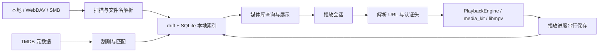
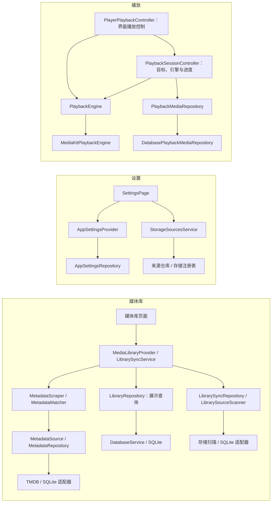
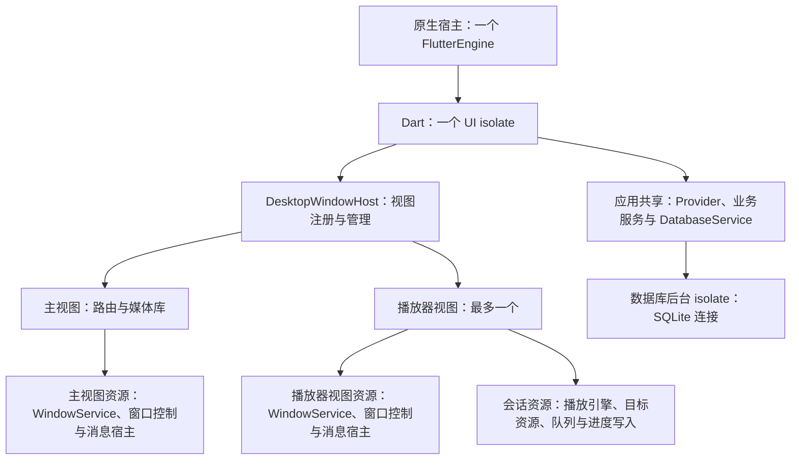

# 架构总览

本文描述当前实现（核对日期：2026-10-27）。功能完成度见 [实施状态](../status.md)，技术取舍见 [ADR](../decisions/)，验证证据见 [测试指南](../guides/testing.md)。

## 系统边界

Mochi Player 是面向 macOS / Windows 的本地优先桌面媒体库播放器。文件系统媒体源包括本地、WebDAV 和 SMB；扫描与 TMDB 刮削形成本地索引，播放器使用 libmpv（经 media_kit）。SMB 浏览 / 扫描使用 dart_smb2，播放通过本地 HTTP Range 回源接入。

这张图表示数据流，不表示各模块直接互相导入。

## 结构与依赖

项目采用按功能组织的分层模块化单体。`app` 负责组装与外壳，`features` 承载首页、媒体库、播放和设置，`core` 提供共享模型、基础设施、平台与 UI，`l10n` 管理语言资源。媒体库按 `catalog / detail / browser / sources / sync / metadata / widgets` 工作流程组织，其他功能保留各自既有布局。具体维护入口见 [媒体库维护地图](../../lib/features/library/README.md)，目录模板和新增代码落位见 [编码指南](../guides/code-organization.md#目录骨架)。

业务调用通常沿“展示交互 → 应用用例 → 仓库 / 外部能力”流动。`core` 不导入 `features` 或 `app`；入口可以选择具体实现，页面通过应用入口操作业务，视图窗口接口与图片资源加载属于展示交互。

`core` 的归属按实际调用判断：媒体记录、观看进度和剧集播放目标由媒体库、播放或共享持久化共同使用；趋势响应模型由共享 TMDB 映射 / 服务返回。仅供媒体库浏览与扫描使用的 `MediaFileKindResolver` 位于 `features/library/media_file_kind.dart`，仅供 SQL 回归比较的续播参考实现位于 `test/support/`，不随应用发布。

### 职责边界

| 领域 | 入口与职责 | 约束 |
| --- | --- | --- |
| 媒体源业务 | [StorageSourcesService](../../lib/features/library/sources/storage_sources_service.dart) 协调配置、测试、删除回调与收尾；[FileBrowserProvider](../../lib/features/library/browser/file_browser_provider.dart) 协调凭据与浏览连接 | 页面只处理输入、确认、展示；SMB 路径解析位于领域层，协议实例不进入页面 |
| 媒体库查询 | [MediaLibraryProvider](../../lib/features/library/media_library_provider.dart) 提供查询订阅，仓库为私有字段；[LibraryQuery](../../lib/features/library/widgets/library_query.dart) 回调接收应用 Provider | 查询身份稳定，通过滚动扩展结果并订阅数据库变更 |
| 媒体库同步 | [LibrarySyncService](../../lib/features/library/sync/library_sync_service.dart) 通过 `LibrarySourceScanner`、`LibrarySyncRepository` 协调扫描与清理，通过应用层 `MetadataScraper` 刮削 | 同步服务不读取凭据、不持有协议连接或 SQLite；完整且未中断的扫描才能清理旧索引 |
| 元数据匹配与导入 | 应用层 `MetadataMatcher`（候选 / 搜索计划同文件） / `MetadataScraper`（结果 / 进度同文件）使用 `MetadataSource`、`MetadataRepository`；基础设施提供 TMDB 与 SQLite 实现 | 请求错误在适配器转换；元数据与关联原子导入，事务不泄漏到编排层 |
| 播放持久化 | [PlaybackMediaRepository](../../lib/features/playback/application/playback_media_repository.dart) 只定义契约；[DatabasePlaybackMediaRepository](../../lib/features/playback/infrastructure/database_playback_media_repository.dart) 独立实现 | 播放会话不导入数据库实现，不使用默认数据库获取路径 |
| 播放器组装与界面 | [player_window_factory.dart](../../lib/app/bootstrap/player_window_factory.dart) 创建视图并协调窗口生命周期；[PlayerWindowController](../../lib/features/playback/application/player_window_controller.dart) 保存启动数据并维护窗口展示状态；[PlayerWindowApp](../../lib/features/playback/presentation/player_window_app.dart) 组装界面并将引擎工厂交给播放会话 | 负责创建、激活、换片、保存进度、释放资源与关闭顺序；创建后初始化失败也会退役视图 |
| 共享依赖 | [ApplicationDependencies](../../lib/app/bootstrap/application_dependencies.dart) 集中组装；数据库、TMDB、设置服务使用普通实例，关键应用 / 适配器构造参数必传 | 主视图和播放器共享数据库；设置运行配置可被趋势和刮削立即使用；测试可独立构造服务 |

`DatabaseService` 管理共享连接与多表写入，`LibraryRepository` 提供展示查询；`DatabaseLibrarySyncRepository` 提供同步所需读写，`DatabaseMetadataRepository` 提供本地元数据读取与原子导入。drift 直接映射部分领域模型，生成代码与表结构见 [数据模型](data-model.md)。

### 命名约定

命名规则统一维护在 [编码指南](../guides/code-organization.md#命名约定)。Provider 表达界面状态，Controller 表达具体交互 / 会话，Service 表达用例或技术能力；后缀不决定依赖作用域。

### 业务调用

下图表示代表性的运行时调用路径，不是完整 import 图。入口组装、图片缓存和窗口操作不混入这张业务图。

播放路径中“契约 → 运行时实现”表示方法调用最终落到适配器，不表示接口文件导入实现。`PlaybackSessionController` 负责目标解析、引擎打开 / 停止 / 释放与进度保存；展示目录中的 `PlayerPlaybackController` 订阅状态、处理界面控制并向会话发出换片 / 关闭请求，其 `subtitles` 入口统一管理字幕选择、外挂文件与样式。具体维护入口见 [播放维护地图](../../lib/features/playback/README.md)。模型和接口被各层使用，省略这些普遍依赖，避免把领域层画成所有箭头的终点。

### 代表调用链

| 操作 | 当前调用路径 | 需要注意的边界 |
| --- | --- | --- |
| 扫描媒体库 | `SettingsPage` → `MediaLibraryProvider.scanMediaSources()` → `LibrarySyncService.scanEnabledMediaSources()` → `LibrarySourceScanner` / `LibrarySyncRepository` → 存储扫描 / SQLite 适配器 | 应用服务负责批次、退出、错误与清理策略；扫描会话封装凭据与连接；SQL 文件写入后，库查询订阅刷新；配置了 TMDB 时后续进行刮削 |
| 收藏标题 | `FavoriteButton` → `MediaLibraryProvider.setFavorite(LibraryItem)` → `DatabaseService.setTitleFavorite()` | 数据层按标题类型批量更新文件；页面通过应用查询入口订阅结果，不持有仓库 |
| 查询详情 | `MediaDetailPage` → `LibraryQuery` → `MediaLibraryProvider.watchDetail()` / `watchVersions()` → 私有 `LibraryRepository` | 查询回调接收应用 Provider，内部仓库不公开；保留 drift 查询订阅与扩展 LIMIT |
| 保存播放进度 | `PlayerPlaybackController` → `PlaybackSessionController` → `PlaybackProgressWriter` → `PlaybackMediaRepository` → `DatabasePlaybackMediaRepository` → `DatabaseService.updateProgress()` | 定时与关闭时提交；串行写入局部字段；契约在应用层，数据库适配在基础设施层 |
| 保存普通偏好 | `SettingsPage` → `AppSettingsProvider.saveSettings()` → `AppSettingsRepository` | 保存到 SharedPreferences；媒体源编辑通过 `StorageSourcesService`，与普通偏好入口分别组织 |
| 测试媒体源 | `SettingsPage` → `StorageSourcesService.testConnection()` → 协议注册表 / 连接 | 临时连接无论读取成功或失败均在 finally 释放；退出时拒绝新操作并等待已接受任务 |
| 打开来源浏览 | `FileBrowserPage` → `FileBrowserProvider.openStorageSource()` → 注入的凭据读取方法 / 存储注册表 | 页面不读取凭据后自行连接；切换、清空与关闭时释放连接，迟到连接不会重新选中来源 |

扫描 / 刮削的具体步骤见 [媒体流水线](media-pipeline.md)，播放的关闭与保存顺序见 [播放](playback.md)，SQL 映射与写入边界见 [数据模型](data-model.md)。

## 运行时：一个引擎、两个视图、一个共享数据库连接

本图箭头表示创建 / 管理关系，省略业务调用。两个视图使用同一组应用共享对象和数据库连接。

原生 runner 创建一个引擎并注册一次插件；Dart 创建窗口。数据库通过后台 isolate 执行，UI 与播放器共享同一连接对象；数据库后台 isolate 不等于第二个播放器引擎。

| 所有者 | 状态 / 资源 | 释放时机 |
| --- | --- | --- |
| 应用 | `PlayerWindowCoordinator`、设置、主题、语言、库任务与数据库 | 主窗口关闭 / 应用退出 |
| 每个视图 | `WindowService`、`WindowControlsController`、消息队列 | 对应视图退役 |
| 播放会话 | `PlaybackEngine`、播放目标资源、队列与进度写入 | 换片后释放前一目标；会话关闭时释放引擎与全部目标 |
| 播放器页面 | 展示状态、窗口模式控制器、计时器与订阅 | 页面替换或播放器关闭 |

共享界面 Provider 包括媒体库、文件浏览、趋势、设置、主题与 `AppLocaleProvider`；窗口接口和消息宿主按视图注入。`AppMessage` 通过调用方 context 找到消息宿主，不通过全局变量猜测窗口。

## 核心契约

| 契约 | 当前实现与边界 |
| --- | --- |
| [StorageAdapter / StorageConnection](../../lib/core/domain/storage/storage_adapter.dart) | 注册表按协议建立连接与列目录；浏览能力与播放协议能力分别验证 |
| [PlaybackTargetResolver](../../lib/core/domain/playback/playback_target_resolver.dart) | 根据媒体源解析 URL 与请求头，不负责媒体服务器的会话上报 |
| [PlaybackEngine](../../lib/features/playback/application/playback_engine.dart) | 播放、seek、轨道、选项、状态流及视频表面；不暴露任意 mpv 属性 API |
| [DatabaseService](../../lib/core/infrastructure/database/database_service.dart) | 共享连接、事务与字段级写入 |
| [LibraryRepository](../../lib/features/library/catalog/library_repository.dart) | SQL 筛选、聚合、有限结果投影与 drift 订阅 |
| [LibrarySourceScanner](../../lib/features/library/sync/library_source_scanner.dart) | 启用来源与扫描会话；`StorageLibrarySourceScanner` 内部解析凭据和连接，调用方在 finally 关闭返回的会话 |
| [LibrarySyncRepository](../../lib/features/library/sync/library_sync_repository.dart) | 同步路径、批量文件写入、失效清理与待匹配候选；`DatabaseLibrarySyncRepository` 实现 |
| [MetadataSource](../../lib/features/library/metadata/metadata_source.dart) | 按 ID / 标题获取元数据与季集，失败通过 `MetadataRequestFailure` 报告；`TmdbMetadataSource` 实现 |
| [MetadataRepository](../../lib/features/library/metadata/metadata_repository.dart) | 本地元数据读取与原子关联导入；`DatabaseMetadataRepository` 实现，应用层不传事务回调 |
| [WindowService](../../lib/core/platform/window_service.dart) | 所属视图的窗口操作；原生桥每次带 `viewId` |

## 生命周期与同步

主窗口关闭意味着整个应用退出，单独关闭播放器保留主窗口与数据库。数据库变更通过共享 drift 订阅刷新界面；语言、主题和设置通过共享 Provider 通知。资源关闭顺序与超时处理统一见 [播放生命周期](playback.md#生命周期与退出)。

## 设计边界

- 同步、匹配和刮削编排依赖应用契约；展示查询、收藏与来源管理仍沿用现有具体仓库 / 服务。接口化由具体测试与替换需求驱动，不将局部边界推广为整个项目满足严格 Clean Architecture。
- `ApplicationDependencies` 负责手工组装与构造注入，在应用范围内共享实例。共享对象由入口负责释放，Provider 通过 `.value` 暴露它们。
- 一个 UI isolate 承载所有视图，同步重任务会影响整个界面；数据库后台 isolate 不代表所有计算都已隔离。
- 播放会话统一管理引擎与目标资源，窗口工厂通过会话关闭入口收尾；详细所有权和失败回收路径见 [播放](playback.md#播放目标资源所有权)。
- 实验窗口 API、原生补丁、凭据存储和大库性能仍有约束；当前风险与待办集中见 [实施状态](../status.md)，平台细节见构建指南。
