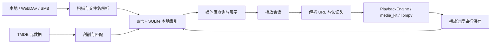
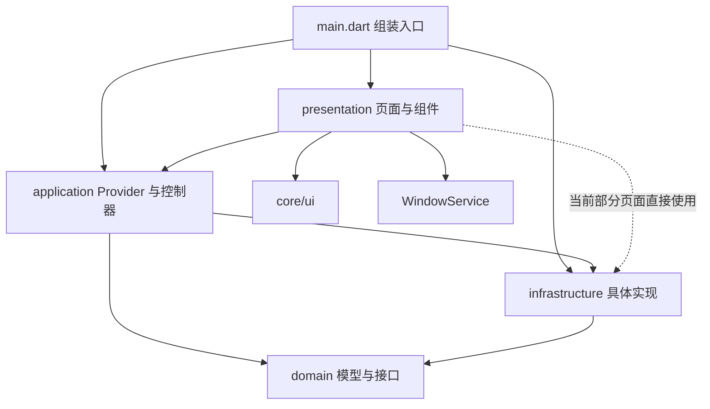
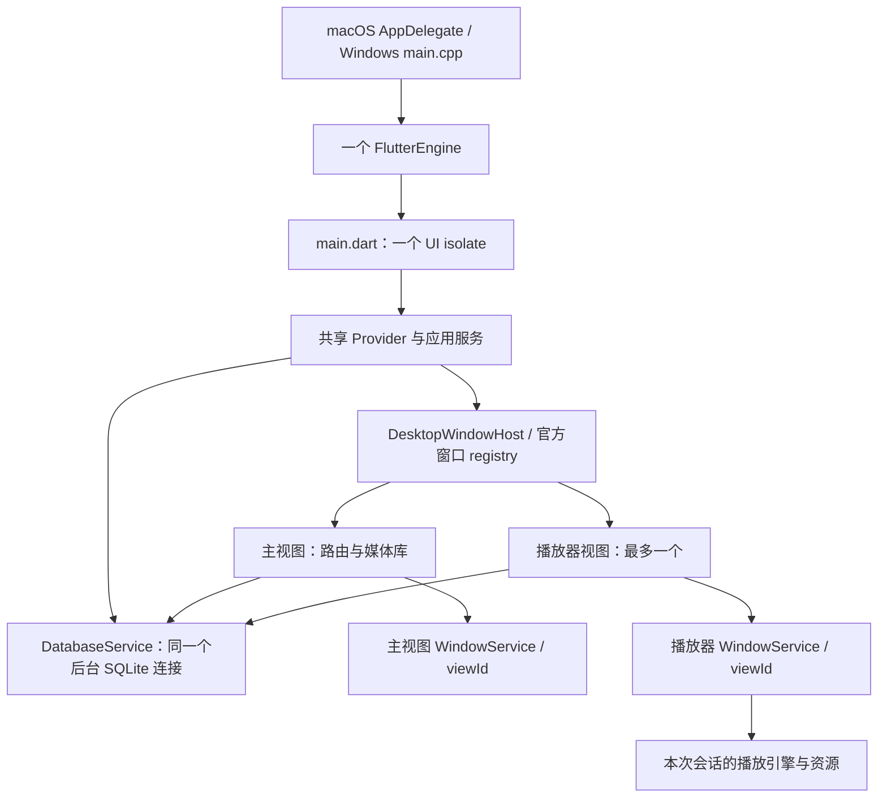

# 架构总览

本文描述当前实现（核对日期：2026-10-14）。功能完成度见 [实施状态](../status.md)，技术取舍见 [ADR](../decisions/)，验证证据见 [测试指南](../guides/testing.md)。

## 系统边界

Mochi Player 是面向 macOS / Windows 的本地优先桌面媒体库播放器。文件系统媒体源包括本地、WebDAV 和 SMB；扫描与 TMDB 刮削形成本地索引，播放器使用 libmpv（经 media_kit）。SMB 可浏览 / 扫描，但当前捆绑播放器不能直接打开或 seek SMB URL；HTTP 回源和媒体服务器接入仍是计划。

这张图表示数据流，不表示各模块直接互相导入。

## 代码分层与依赖

| 目录 | 职责 | 主要入口 |
| --- | --- | --- |
| `app/` | 路由、应用外壳、整体退出 | `app/routing/`、`app/application/` |
| `core/domain/` | 共享领域模型、存储 / 播放目标接口、续播规则 | `media/`、`storage/`、`playback/` |
| `core/infrastructure/` | SQLite、存储协议、TMDB 实现 | `database/`、`storage/`、`tmdb/` |
| `core/platform/` | 视图级窗口接口及平台适配 | `WindowService`、`DesktopWindowHost` |
| `core/ui/` | 主题、组件、展示格式 | `app_ui.dart` |
| `features/` | 首页、媒体库、播放、设置的应用逻辑与界面 | 各功能的 `application / domain / infrastructure / presentation` |
| `l10n/` | 英文模板、中文译文、共享语言控制器 | `app_en.arb`、`app_zh.arb` |
| `main.dart` | 初始化并组装共享依赖、主窗口及播放器工厂 | [启动入口](../../lib/main.dart) |

项目采用按功能组织的分层模块化单体，尚不是上层全部依赖接口的严格 Clean Architecture。下图箭头表示导入 / 使用方向：

- `core/` 不导入 `features/`；共享能力放在 `core/`。
- `PlaybackEngine` 与存储接口隔离后端类型；`application` 中仍有数据库、TMDB 等具体实现依赖。
- 设置页、图片组件和播放器组装入口等仍直接引用基础设施；这是当前边界，不应写成“展示层完全不访问基础设施”。
- 库查询返回页面投影，不再由全量内存 Catalog 承担筛选与聚合。UI 包独立迁移尚未进行，旧 Material/Cupertino 导入的弃用提示仍可见。

## 运行时：一个引擎、两个视图、一个共享数据库连接

原生 runner 创建一个引擎并注册一次插件；Dart 创建窗口。数据库通过后台 isolate 执行，UI 与播放器共享同一连接对象；数据库后台 isolate 不等于第二个播放器引擎。

| 所有者 | 状态 / 资源 | 释放时机 |
| --- | --- | --- |
| 应用 | `PlayerWindowCoordinator`、设置、主题、语言、库任务与数据库 | 主窗口关闭 / 应用退出 |
| 每个视图 | `WindowService`、`WindowControlsController`、消息队列 | 对应视图退役 |
| 播放会话 | `PlaybackEngine`、播放队列、进度写入与窗口模式控制器 | 换片或播放器关闭 |

共享 Provider 包括媒体库、文件浏览、趋势、设置、主题与 `AppLocaleController`；窗口接口和消息宿主按视图注入。`AppMessage` 通过调用方 context 找到消息宿主，不通过全局变量猜测窗口。

## 核心契约

| 契约 | 当前实现与边界 |
| --- | --- |
| [StorageProvider / StorageConnection](../../lib/core/domain/storage/storage_provider.dart) | 注册表按协议建立连接与列目录；浏览能力与播放协议能力分别验证 |
| [PlaybackTargetResolver](../../lib/core/domain/playback/playback_target_resolver.dart) | 根据媒体源解析 URL 与请求头，不负责媒体服务器的会话上报 |
| [PlaybackEngine](../../lib/features/playback/application/playback_engine.dart) | 播放、seek、轨道、选项、状态流及视频表面；不暴露任意 mpv 属性 API |
| [DatabaseService](../../lib/core/infrastructure/database/database_service.dart) | 共享连接、事务与字段级写入 |
| [LibraryRepository](../../lib/features/library/infrastructure/library_repository.dart) | SQL 筛选、聚合、有限结果投影与 drift 订阅 |
| [WindowService](../../lib/core/platform/window_service.dart) | 所属视图的窗口操作；原生桥每次带 `viewId` |

## 生命周期与同步

主窗口关闭意味着整个程序退出：先拒绝新任务，保存 / 释放播放器，再收尾应用任务与偏好、关闭数据库，最后结束进程。单独关闭播放器保留主窗口与数据库。失败或无响应经过有界等待后继续退出，不承诺超时场景一定保存最后快照。详细顺序见 [播放生命周期](playback.md#生命周期与退出)。

数据库变更由共享连接的 drift 订阅刷新媒体库；语言、主题与设置由共享 Provider 通知。不再使用窗口 RPC、版本化 JSON 启动协议、语言快照或跨连接手动查询失效。小窗采用 mini，系统画中画暂不纳入计划。

## 当前设计限制

- 部分上层依赖具体实现，数据库和 TMDB 服务仍使用单例；接口化按实际替换 / 测试需求推进。
- 单个 UI isolate 中的同步重任务会影响两个视图；数据库已移到后台，但不能据此宣称所有计算都已隔离。
- 实验窗口 API 与固定 main SDK 需要持续验证插件、原生交互和发布。
- 大库分页、搜索与索引效果尚无容量基线；不把实现了 SQL 等同于性能已验证。
- 元数据匹配错误分类、凭据存储和元数据回收仍待完善，见 [数据模型](data-model.md) 与 [媒体流水线](media-pipeline.md)。
