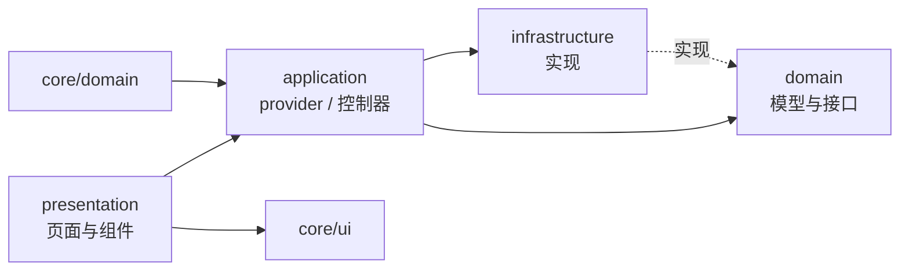
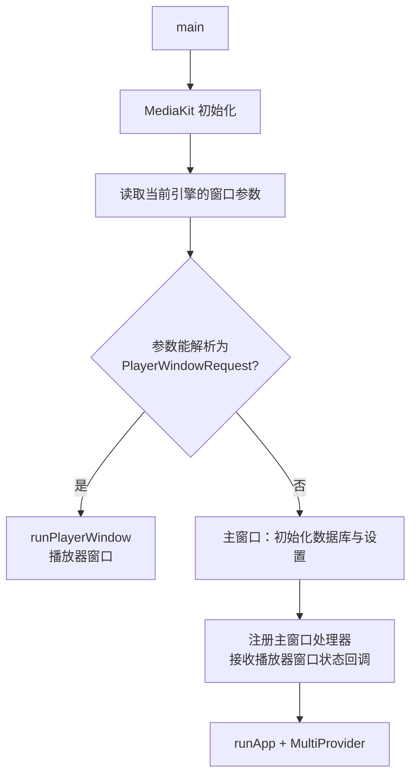

# 架构总览

本文描述**现状**（代码是怎么组织的）；要做什么改动见 [决策记录](../decisions/)。

## 分层与目录

```
lib/
├── app/        应用外壳：侧边栏、页面骨架、路由
├── core/       跨功能共享：领域模型、基础设施、设计系统、平台适配
│   ├── domain/         领域模型与接口（media / storage / playback）
│   ├── infrastructure/ 接口实现（database / storage / tmdb）
│   ├── ui/             设计系统：theme + components + formatters
│   └── platform/       平台窗口控制
├── features/   按功能划分：home / library / playback / settings
│   └── <feature>/{application,domain,infrastructure,presentation}
└── main.dart   入口，同时区分「媒体库主窗口」与「播放器窗口」
```

当前主要依赖方向：



- `presentation` 只通过 `application` 拿状态，不直接访问数据库或网络客户端。
- `infrastructure` 实现 `core/domain` 中的部分接口（如 `StorageProvider`、`PlaybackTargetResolver`）；但当前多个 `application` 类仍直接导入数据库、TMDB、存储等具体实现（例如 [library_sync_controller.dart](../../lib/features/library/application/library_sync_controller.dart)）。因此图描述的是主要依赖关系，项目尚未做到上层完全依赖接口。
- `core/` 不依赖 `features/`；跨功能的能力沉淀到 `core/`。
- 所有导入使用包路径（`package:mochi_player/...`），由 `always_use_package_imports` 强制。

## 启动流程

[main.dart](../../lib/main.dart) 用同一份入口代码区分两种窗口：



- 播放器窗口靠自己重新初始化数据库（[player_window_app.dart](../../lib/features/playback/presentation/player_window_app.dart)），因此同一进程内有两个后台 SQLite 连接，使用 WAL 与 `busy_timeout` 协调访问。当前保留该方案，单写者按收益和实测问题另行评估，见 [0001](../decisions/0001-multi-window-strategy.md)。
- 主窗口注册的处理器负责接收播放器窗口关闭时回传的进度变更（见 [playback.md](playback.md)）。
- 生命周期目标为关闭主窗口即退出整个应用，单独关闭播放器则保留主窗口。主窗口通过应用退出协调器等待播放器最终进度提交及资源清理，再关闭主数据库并退出进程；超时或失联时结束整个进程，不保留后台播放器。

## 全局 Provider

在 [main.dart](../../lib/main.dart) 中一次性注入：

| Provider | 职责 |
| --- | --- |
| `AppSettingsProvider` | 应用设置（TMDB、缓存、字幕），并把设置应用到运行时单例 |
| `MediaLibraryProvider` | 媒体库门面：委托查询与同步控制器 |
| `FileBrowserProvider` | 文件浏览的目录、排序、搜索状态 |
| `ThemeProvider` | 主题模式与强调色（持久化在 SharedPreferences） |
| `TrendingMediaProvider` | 首页 TMDB 趋势（不落库） |
| `WindowControlsController` | macOS 原生窗口按钮控制 |

状态刷新的约定：SQLite 是持久化数据源，`LibraryRepository` 提供分页 SQL 查询与 drift 订阅。`MediaLibraryProvider` 只保留有限的首页展示投影与同步任务状态，UI 以稳定查询订阅或投影比较决定重建。全量 Catalog 与手工修订号已删除。独立播放器连接的更新由既有跨窗口事件触发查询失效，见 [0003](../decisions/0003-persistence-migration.md)。

## 核心抽象

| 抽象 | 位置 | 作用 |
| --- | --- | --- |
| `StorageSource` / `StorageCredentials` | [core/domain/storage](../../lib/core/domain/storage/storage_source.dart) | 媒体源配置；凭据刻意与配置分离，避免在列表中泄露 |
| `StorageProvider` / `StorageConnection` | [core/domain/storage](../../lib/core/domain/storage/storage_provider.dart) | 按协议连接与列目录；`StorageProviderRegistry` 按类型分派 |
| `PlaybackTargetResolver` / `PlaybackTarget` | [core/domain/playback](../../lib/core/domain/playback/playback_target.dart) | 把媒体文件解析成播放 URL 与请求头 |
| `DatabaseService` | [core/infrastructure/database](../../lib/core/infrastructure/database/database_service.dart) | 数据库统一出口（每引擎单例） |
| `LibraryRepository` | [library_repository.dart](../../lib/features/library/infrastructure/library_repository.dart) | SQL 查询、分页、聚合与订阅，按标题加载详情与播放队列 |
| `TmdbService` | [core/infrastructure/tmdb](../../lib/core/infrastructure/tmdb/tmdb_service.dart) | TMDB 请求、匹配与转换（单例）；客户端由设置在运行时配置 |
| `AppTheme` + `core/ui/components` | [core/ui](../../lib/core/ui/app_ui.dart) | 设计系统：颜色、字号、间距、圆角、组件库 |

## 已知架构问题

| 问题 | 影响 | 决策 |
| --- | --- | --- |
| 一个窗口一个 Flutter 引擎 | Windows 主窗口可能无响应；两个引擎各开 SQLite 连接 | [0001](../decisions/0001-multi-window-strategy.md) |
| 数据访问是全表加载 + 内存重算 | 大库性能与刷新粒度问题 | [0003](../decisions/0003-persistence-migration.md) |
| media_kit 有限维护 | 播放后端已隔离，原生渲染、捆绑构建和关键补丁仍需自行验证 | [0002](../decisions/0002-playback-engine.md) |
| SMB 直链依赖预编译产物是否含某协议 | 功能可用性不可控 | [0005](../decisions/0005-smb-playback-path.md) |
| 媒体服务器包含目录浏览、播放协商与服务端会话，不能由文件系统源抽象完整表达 | 需独立的服务端接入与播放生命周期 | [0006](../decisions/0006-media-server-integration.md) |
| 无本地化工具链，文案硬编码 | Material 系统文案为英文 | [0004](../decisions/0004-i18n-l10n.md) |
