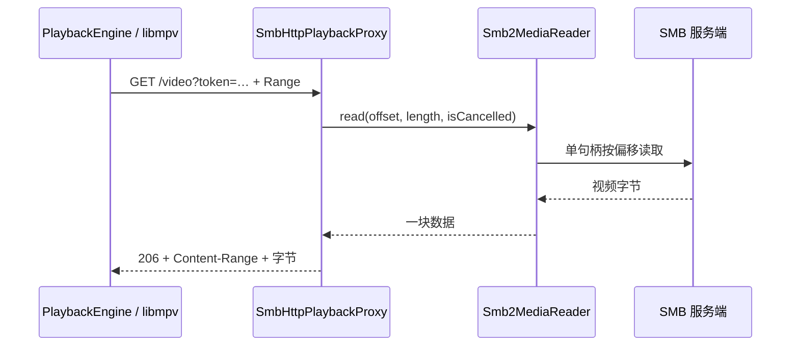
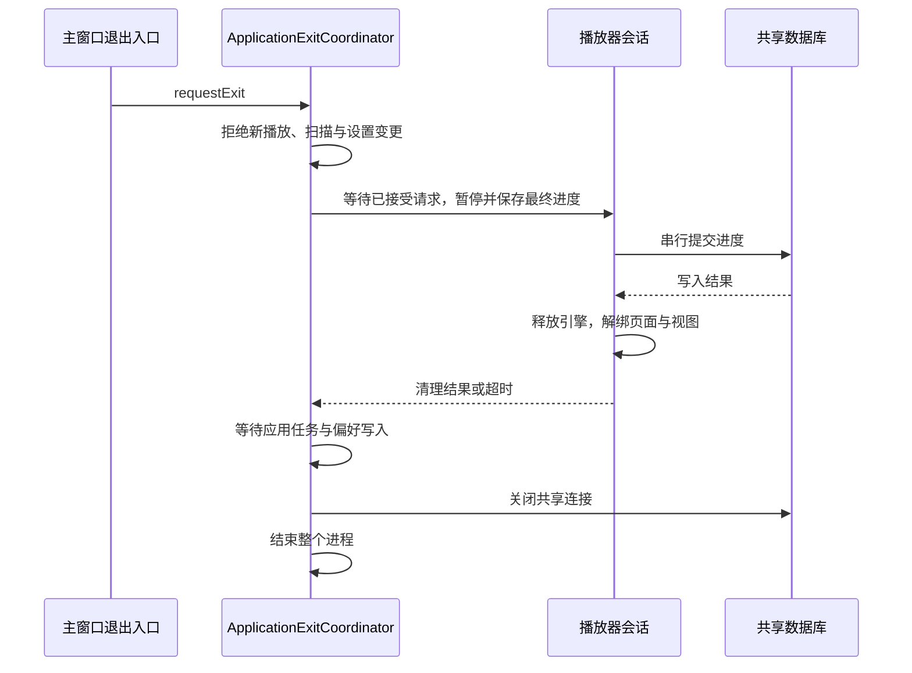

# 播放

核对日期：2026-10-27。本文描述「点击播放」到「进度写回媒体库」的链路与同引擎会话调用。维护入口见 [播放维护地图](../../lib/features/playback/README.md)，功能状态见 [实施状态](../status.md)，验证证据见 [测试指南](../guides/testing.md)。

## 入口与播放请求

- 媒体库播放入口：`LibraryPlaybackLauncher` 的 `playFile` / `playMovie` / `playTVShow` / `playEpisode`（[library_playback_launcher.dart](../../lib/features/library/ui/library_playback_launcher.dart)）。版本选择和队列查询归属媒体库，完成后向播放功能提交请求；播放功能不导入媒体库 Provider。
- 播放队列：由 `MediaLibraryProvider.getPlaybackQueue` 生成——剧集按剧集分组、排序、去重；电影等为单元素队列。
- 请求对象：[player_window_request.dart](../../lib/features/playback/domain/player_window_request.dart)，在同一 isolate 内传递 `MediaFile`、队列和请求 ID。
- [PlayerWindowCoordinator](../../lib/features/playback/application/player_window_coordinator.dart) 通过 Provider 注入，串行创建 / 替换单个会话；播放入口直接调用协调器。[player_window_factory.dart](../../lib/app/bootstrap/player_window_factory.dart) 创建独立视图并协调窗口生命周期；[PlayerWindowController](../../lib/features/playback/application/player_window_controller.dart) 保存启动数据与窗口展示状态；[player_window_app.dart](../../lib/features/playback/ui/player_window_app.dart) 负责界面，共享设置、语言与主题。引擎工厂、数据库播放适配和目标解析器均由组装入口注入。
- [PlaybackMediaRepository](../../lib/features/playback/application/playback_media_repository.dart) 是应用契约；[DatabasePlaybackMediaRepository](../../lib/features/playback/data/database_playback_media_repository.dart) 是基础设施实现，使用注入的共享数据库。播放会话不自行创建数据库服务或媒体源解析器。
- 播放器优先按 `sourceId + path` 读取已入库记录；查不到时使用临时快照继续解析媒体源。因此文件浏览器播放不依赖扫描或 TMDB 刮削。未入库媒体的播放进度不会写入媒体库，扫描入库后才支持续播。

## 播放目标解析

播放会话取得 `MediaFile` 后，交给 [StorageSourcePlaybackResolver](../../lib/core/data/storage/storage_source_playback_resolver.dart) 按媒体源类型分派：

| 类型 | 解析结果 | 说明 |
| --- | --- | --- |
| 本地 | `file://` URL | 校验路径必须落在媒体源根目录内 |
| WebDAV | HTTP(S) URL + `Authorization: Basic` 头 | 由 FFmpeg 的 http 协议与 Range 支撑 |
| SMB | `http://127.0.0.1:<临时端口>/video?token=<会话令牌>` | dart_smb2 打开单个文件，通过本地 HTTP Range 转发；SMB 凭据不进入 URL，选型见 [0005](../decisions/0005-smb-playback-path.md) |

媒体源被停用或不存在时解析失败，由播放器窗口展示失败信息，主窗口不重复报错。

### SMB HTTP 回源

[解析器](../../lib/core/data/storage/smb_playback_resolver.dart) 打开 SMB 文件，启动本机 HTTP 服务并返回播放地址。播放器通过 Range 请求读取所需字节：

| 边界 | 当前机制 |
| --- | --- |
| 文件读取 | dart_smb2 持久句柄，长度取自实际打开文件；同一句柄的读取串行化，避免重连竞争 |
| 凭据与连接 | 共用来源仓库的凭据读取入口；播放持有独立连接，不借用浏览的活动句柄；初始连接创建排队 |
| 监听与访问 | 只绑定 `127.0.0.1:0`，系统分配可用端口；每个目标生成 256 位安全随机令牌，校验 Host、路径和令牌，不提供目录或任意路径访问 |
| 日志 | 令牌放查询参数，由播放日志脱敏；SMB 账号密码不交给播放器 |
| HEAD | 返回文件长度和范围读取能力，不读视频正文，忽略 Range |
| GET / Range | 完整 200，单段 / 开放结束 / 后缀范围 206，越界 416；无效 / 多段 Range 或未知 If-Range 回退完整响应 |
| 背压 | 每块最多 256 KiB，写入后等待 HTTP flush；读取 / 写入等待上限 12 秒，播放 SMB 协议超时 8 秒 |
| 快速 seek | 最多保留 4 个活动传输；达到上限时，新请求替换最早的传输，优先处理最新 seek |
| 取消 | 排队读取进入原生调用前检查取消状态；已执行的单块读取完成后丢弃结果。超时任务也标记取消，防止稍后继续读取 |
| 关闭 | 先关闭 HTTP 连接，再释放 SMB 句柄和 worker；关闭操作幂等 |

真实服务端与性能的验收范围见 [实施状态](../status.md)，协议测试和原生冒烟见 [测试指南](../guides/testing.md)。需要时仍可在系统中挂载 SMB，再作为本地媒体源播放。

## 播放目标资源所有权

`PlaybackSessionController` 统一持有播放目标与引擎。`PlaybackTarget` 包含 URL、请求头和可选资源；SMB 资源是 HTTP 回源服务及其读取器。

| 阶段 | 会话负责的操作 |
| --- | --- |
| 准备 | 解析并接管目标，窗口或引擎尚未创建时也由会话保管；解析器负责创建失败时的内部清理 |
| 创建引擎 | 使用注入的工厂创建，构造失败时释放已准备的目标；界面借用引擎展示与控制播放 |
| 队列换片 | 保存进度、准备下一目标并打开；操作完成前拒绝重复换片，保留前一目标供引擎读取；打开完成后释放前一目标 |
| 准备失败 | 保留当前媒体、引擎与资源，界面展示链接错误 |
| 打开失败 | 等待引擎 stop 后释放相关目标；若 stop 失败，销毁引擎并关闭会话，界面展示播放错误 |
| 退出准备 | 拒绝新操作，等待已接受操作，暂停引擎并保存最终进度；打开尚未完成的媒体不写进度 |
| 关闭 | 先销毁引擎，再释放全部目标；单个释放失败仍尝试其余目标；重复关闭复用同一操作，迟到解析结果自行释放 |

窗口工厂只持有会话并调用关闭入口，覆盖窗口创建失败、替换未采用和页面未挂载等路径。展示控制器负责状态订阅与界面通知；换片通知只重置界面状态，资源释放由会话内部完成。

引擎 open 的 Future 表示打开命令完成，不代表视频已成功解码。后续异步播放错误由状态流展示，目标在会话下一次切换或关闭时释放。会话只在目标成功打开后接受进度写入，避免把前一个文件的位置写到新文件。

## 播放引擎

窗口入口注入 `MediaKitPlaybackEngine` 工厂，会话创建并持有引擎，`PlayerPlaybackController` 借用引擎。控制器和控制栏通过 [PlaybackEngine](../../lib/features/playback/application/playback_engine.dart) 使用项目状态与轨道类型，执行播放控制、状态订阅、选轨、字幕覆盖和缓存速度查询；视频视图也由后端提供。

[MediaKitPlaybackEngine](../../lib/features/playback/data/media_kit_playback_engine.dart) 内部创建 `Player`（启用 libass）与 `VideoController`，将 `PlaybackTarget` 的 URL、请求头与续播起点转换为后端媒体对象。以下 mpv 参数仅在此实现中下发：

| 参数 | 取值来源 |
| --- | --- |
| `cache` / `cache-pause` / `cache-pause-wait` | 固定值 |
| `cache-secs` / `demuxer-readahead-secs` | 设置：预读秒数 |
| `demuxer-max-bytes` / `demuxer-max-back-bytes` | 设置：缓存大小（后者为 1/4） |
| `hwdec` | 设置：硬件解码开关（`auto` / `no`） |
| `slang` | 设置：字幕语言优先级 |
| `vo-profile` | 固定 `high-quality` |

门面不暴露任意属性读写；缓存速度通过 `readCacheBytesPerSecond` 返回数值，字幕模式经类型明确的方法设置。参数实现与维护风险见 [0002](../decisions/0002-playback-engine.md)。

## 窗口模式

尺寸均为逻辑像素；以下是窗口尺寸与恢复行为的统一说明。

| 窗口 / 模式 | 尺寸约束 | 行为 |
| --- | --- | --- |
| 主窗口 | 最小 900×600 | 承载媒体库；关闭即退出整个应用 |
| 普通播放器 | 最小 720×405 | 最多一个窗口，新请求通过 `PlayerWindowSession.replace` 替换内容 |
| mini 播放器 | 480×300，最小 420×260 | 以原窗口右下角为锚点，默认置顶；macOS 隐藏原生窗口按钮 |
| 全屏 | 由系统管理 | 区分应用内状态与系统状态，退出后同步 |

mini 复用同一播放会话、字幕和控制界面，不接入系统 PiP。进入前保存尺寸、最大化与置顶状态，退出后恢复原状态及常规约束。进入失败尝试撤回修改；恢复失败保留记录供重试，成功后才清除；置顶失败读取实际状态。

窗口操作使用按视图注入的 `WindowService` 和显式 `viewId`，不使用全局“当前窗口”。`DesktopWindowHost` 管理官方 registry；尺寸约束、激活和全屏走官方控制器，拖动、位置、普通置顶和文件对话框由原生桥补充。接口与平台规避分别见 [macOS](../guides/build-macos.md#窗口外观) 和 [Windows](../guides/build-windows.md#官方窗口宿主)。

## 生命周期与退出

会话的 `prepareClose()` 负责暂停与最终进度，`close()` 负责引擎和目标释放；窗口关闭协调器为这些阶段设置超时；页面清理与未挂载页面的会话收尾共用同一资源阶段。

关闭主窗口进入 `ApplicationExitCoordinator`：拒绝新请求，等待已接受的会话操作、最终进度和资源释放，注销视图并等待一帧，再销毁窗口；随后收尾任务、设置与共享数据库，结束进程。播放器单独关闭不关闭共享数据库。

重复退出复用同一操作。播放器阶段最多 18 秒，应用清理阶段最多 8 秒；macOS 原生退出有 30 秒兜底。播放器内部对替换 / 保存 / 解绑帧阶段各等待最多 2 秒，资源释放与窗口恢复阶段最多 12 秒。失败继续后续清理，超时 / 强制结束不保证最后快照已保存，不能把“进程退出”当作“保存成功”。

替换播放请求先解析新目标；成功后保存、释放旧播放资源并移除旧页面一帧，再挂载新页面，避免两个页面同时拥有资源回调。目标解析失败保留原播放。语言变化只重建文案，不替换播放会话。

macOS 退出原生通道将 Cmd+Q / Dock 退出导向同一退出协调器；窗口原生通道通过 `viewId` 定位目标窗口。

## 字幕

入口为 [PlayerSubtitleController](../../lib/features/playback/ui/controllers/player_subtitle_controller.dart)，集中维护轨道订阅、语言优先级、手动选择、外挂文件身份和样式覆盖。页面通过 `PlayerPlaybackController.subtitles` 访问；播放控制器负责创建、转发状态通知、换片时重置及关闭时取消字幕订阅，字幕控制器只借用引擎。

- **语言优先级**：默认 `zh,chi,zho,chs,cht,eng`，既用于自动选轨，也直接写入 mpv 的 `slang`。
- **外挂字幕**：视图所属的系统文件对话框限定 `srt / ass / ssa / vtt`；加载后按轨道标题回查（引擎不会回传新轨标识）。
- **样式覆盖**：开启覆盖时，把 `sub-ass` / `sub-visibility` / `secondary-sub-visibility` 统一置为关闭，改由 Flutter 依据播放器上报的字幕文本自行绘制，字号按播放器视口换算；关闭覆盖时交回 libass 处理。

外挂字幕在切换媒体时会清空，不跨集保留；样式覆盖偏好保留。开始准备换片时使旧异步字幕操作失效，实际换片时清空字幕状态。旧请求迟到成功或失败均不能更新新媒体状态；关闭前停止接收字幕事件，取消订阅后由播放会话释放引擎。

## 进度与续播

| 环节 | 规则 |
| --- | --- |
| 周期保存 | 每 10 秒一次（[player_playback_controller.dart](../../lib/features/playback/ui/controllers/player_playback_controller.dart)） |
| 位移阈值 | 与上次保存位置相差不足 5000ms 时跳过（`PlaybackSessionController.saveProgress`） |
| 强制保存 | 切换剧集、播放完成、关闭窗口前、组件销毁兜底 |
| 写入顺序 | `PlaybackProgressWriter` 串行化，避免旧快照覆盖新位置 |
| 落库 | `DatabasePlaybackMediaRepository` → `AppDatabase.updateProgress`（同时推导观看状态，见 [data-model.md](data-model.md)） |
| 续播策略 | 位置回退 5 秒后开始；位置为 0 不续播；已完成（≥95%）不续播（[playback_resume_policy.dart](../../lib/features/playback/domain/playback_resume_policy.dart)） |

## 设计限制

- 播放控制器仍协调打开 / 换片、进度、音轨、日志与缓冲；字幕流程独立维护。播放设置在页面初始化时读取，运行中修改不即时应用。
- 观看完成阈值仍在多处出现，规则与数据影响见 [数据模型](data-model.md)。
- 平台交互、维护风险与待验收范围集中见 [实施状态](../status.md)，不从隔离短片推断真实媒体与长期稳定性。
